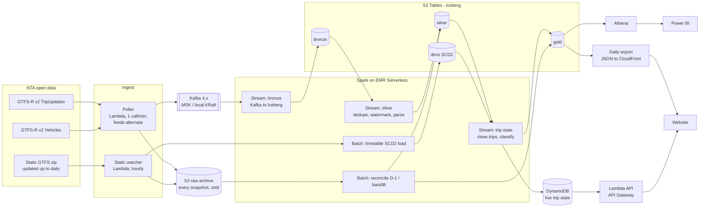

# Ghost Bus Radar: the plan

**Status:** plan only, 15 November 2026. No pipeline code yet. Read this, then `SPRINTS.md`.
Research findings and sources are in [`docs/01-research.md`](docs/01-research.md).

---

## 1. The one-paragraph pitch

Dublin's real-time boards show buses that never come. The NTA says these "ghost buses" happen
when an operator cancels a trip too late for the real-time system to notice. Dublin Bus says its
real-time accuracy is 98 to 99 per cent. Passengers disagree, and the only public evidence is a
crowdsourced tracker whose data the NTA has questioned. **Nobody publishes an independent,
reproducible count per route, stop and hour.** Ghost Bus Radar is that count. It compares every trip
in the official timetable with what the NTA's own real-time feeds report, classifies each trip
(ran, cancelled in time, cancelled late, ghost, vanished mid-route), and publishes the numbers
through a website, an API, and a BI dashboard. A new national AVL system (Trapeze) is being piloted
from September 2026, so the project can also measure whether the replacement actually helps.

## 2. What "really successful" means here

A portfolio project succeeds when a reviewer can verify the claims in five minutes. So the bar is:

1. **A real number, defended.** "Route X ghosted 7.4 per cent of its trips between 18:00 and 19:00
   on weekdays in November" with a written method, a stated error margin and a small field check.
2. **Production signals, demonstrated rather than claimed.** A test that kills the streaming job
   mid-batch and proves zero duplicate rows. A replay of a week of archived data through the same
   code. A timetable change handled without breaking history.
3. **Something people can use.** A public page: type a stop, see upcoming buses and how likely each
   is to turn up, with the probability calibrated and the calibration shown.
4. **A cost story.** The whole AWS stack can run for a showcase window and then shrink to a few euro
   a month without the website going dark.

## 3. What we are building

| Surface | Who it is for | What it does |
|---|---|---|
| **Website** (public) | Commuters, reviewers | League table of worst routes, route and stop pages, hour-by-hour heatmaps, "will my bus come?" stop lookup, methodology page |
| **API** (Lambda + API Gateway) | The website, anyone | `GET /v1/stops/{code}/departures`, `GET /v1/routes/{route}/reliability`, `GET /v1/health` |
| **BI dashboard** (Power BI, see decisions) | Analysts, interviewers | Punctuality and ghost rate by route, stop, hour, operator; trend lines; before/after the AVL pilot |
| **Lakehouse** (Iceberg on S3 Tables) | Engineers | Bronze/silver/gold tables queryable from Athena |

## 4. Architecture



### The key idea: the raw archive is the source of truth, Kafka is the transport

The poller writes **every snapshot it fetches to S3 first**, then publishes to Kafka. Three things
fall out of this for free:

- **Backfill.** If Kafka or Spark is down, nothing is lost. A batch job replays the archive through
  the same transformation code. This is the "backfill path for outages" from the brief.
- **Cheap continuous collection.** The poller and archive cost a few euro a month, so we can start
  collecting history in week one and only pay for MSK and EMR when we want to demo them.
- **Reproducibility.** Every published number can be regenerated from raw files.

## 5. Data facts that shape the design

These came out of the research and each one changes the code. Sources in `docs/01-research.md`.

| Fact | Consequence |
|---|---|
| v2 `trip_id` and `route_id` are autogenerated and **regenerated on every static upload**. NTA says not to use them as identifiers | Durable keys are natural keys: route = (agency, `route_short_name`, type, plus long name for rail); trip instance = (route, direction, service date, first departure time, first stop, duplicate index). Raw IDs kept only for joining within one feed version (ADR-0002, ADR-0006) |
| Real-time data only matches the **static GTFS of the same version**, and static can change daily | Every static file is versioned (hash), loaded as SCD type 2, and realtime is joined to the version that was live at observation time. Unmatched-ID rate is a monitored metric |
| `stop_id` is the NaPTAN AtcoCode, `stop_code` is the plate number on the pole | Stops are the one stable key. The API takes the plate number, because that is what people see |
| `agency_timezone` is published as `Europe/London` | Same offset as Dublin all year, but we normalise to `Europe/Dublin` and test DST weekends explicitly |
| `stop_times` can exceed 24:00:00 (trips after midnight belong to the previous service day) | Trip-instance expansion handles service day versus calendar day; property-based tests cover it |
| Feeds: `https://api.nationaltransport.ie/gtfsr/v2/TripUpdates` and `/Vehicles`, key in `x-api-key` header, protobuf by default, `?format=json` reported to work | Poller stores protobuf (smaller), parses with `gtfs-realtime-bindings` |
| The NTA usage policy allows **one call to the GTFS-R API every 60 s per token** (read in S1, `docs/02-nta-usage-policy.md`) | One call a minute for the whole API: TripUpdates and Vehicles alternate (each every 2 min), Alerts one minute in 15 (ADR-0005). Not probed |
| v2 adds Luas and Irish Rail to TripUpdates; Vehicles coverage for rail is unknown | Bus is the primary scope. Rail and Luas get punctuality only until we confirm vehicle coverage |
| Static GTFS is CC BY 4.0 (attribution to NTA). Realtime is under the developer portal usage policy | Attribution on every page. Read the usage policy before the website goes public |

## 6. Defining a ghost (the part that makes or breaks credibility)

A "ghost" is easy to say and hard to measure, because we never see the bus itself, only what the
NTA systems report. So the project reports **categories**, not one scary number, and is explicit
about what each one can and cannot prove. The full spec is `docs/03-ghost-definition.md` (it supersedes the first draft below, as of Sprint 4).

Every scheduled trip instance (from the timetable, for every service day) ends in exactly one
outcome, decided once the trip's scheduled end plus a grace period has passed:

| Outcome | Rule (first draft, thresholds tuned in Sprint 4) | What a passenger experienced |
|---|---|---|
| `RAN` | Vehicle positions observed and progressed through at least 60% of the stops | A bus came |
| `CANCELLED_EARLY` | `CANCELED` in TripUpdates at least 15 min before scheduled departure | Honest cancellation, visible in TFI app |
| `CANCELLED_LATE` | `CANCELED` published after, or under 15 min before, scheduled departure | Already waiting when it was pulled |
| `GHOST` | Never cancelled, and no vehicle was ever tracked on the trip | The board showed it and it never came |
| `PHANTOM_LIVE` | TripUpdates gave live predictions, but no vehicle position ever appeared | Board showed a live countdown to nothing |
| `VANISHED` | Tracked, then lost for more than 15 min before reaching 60% of stops | Bus disappeared from the board mid-route |
| `NO_DATA` | Our own ingestion had a gap during the trip window | **Excluded** from every rate. Never counted as a ghost |

Honesty rules:

- "Never tracked" is not proof the bus never ran (the AVL box could be broken). The site says
  **"untracked"** in headlines and explains the gap. A field check in Sprint 4 (you standing at
  two or three stops for a few peak hours, about 50 observations) gives a rough measure of how often
  untracked buses actually turn up. That single check is what turns this from a dashboard into
  evidence.
- Ingestion gaps come from our own heartbeat table, so our downtime never inflates the ghost rate.
- Every rate is shown with its sample size and a confidence interval (Wilson). Routes with fewer
  than 30 trips in a window are not ranked.

## 7. Streaming design and the production signals

### Kafka topics (main feeds 6 partitions, key = `trip_key`)

| Topic | Payload | Retention |
|---|---|---|
| `gtfsr.trip_updates.v1` | One message per `TripUpdate` entity, plus feed header timestamp, fetch id, static version | 7 days |
| `gtfsr.vehicle_positions.v1` | One message per `VehiclePosition` entity | 7 days |
| `ingest.heartbeat.v1` | One per poll: status, latency, entity count, HTTP code | 30 days |
| `*.dlq` | Messages that failed to parse, with the error | 30 days |

Producer is idempotent (`enable.idempotence=true`, `acks=all`). Schemas are JSON Schema in the repo
(`packages/core/src/ghostbus_core/schemas/`), checked in CI; a schema registry is a stretch goal.
The key is `trip_key` (`start_date|trip_id`, or `start_date|route|direction|start_time` for ADDED
trips): stable within one static version, which is all partition ordering needs. The durable
natural key of ADR-0002 needs the timetable and is derived in silver (Sprint 2/3).

### Spark jobs

| Job | Type | Reads | Writes | Notes |
|---|---|---|---|---|
| `bronze_ingest` | Streaming | Kafka | `bronze.*` | Plain append. Iceberg's streaming sink records `spark.sql.streaming.queryId` and `epochId` in each snapshot and skips epochs it already committed, so a restart cannot double-write |
| `silver_events` | Streaming | bronze | `silver.trip_update_events`, `silver.vehicle_positions`, `silver.stop_time_predictions` | Event time = vehicle timestamp, else feed header timestamp. Watermark 10 min. `dropDuplicatesWithinWatermark` on (entity id, event timestamp). Late rows past the watermark are not lost: they stay in bronze and the nightly reconcile picks them up |
| `trip_state` | Streaming, `foreachBatch` | silver + timetable | `gold.trip_outcomes`, `gold.stop_arrivals`, DynamoDB live state | Every micro-batch closes trip instances whose scheduled end + 30 min is behind the watermark, left-anti-joins the timetable against observations to find trips with **no events at all** (the ghosts), and `MERGE`s results. Idempotent by key, and the batch id goes in the snapshot summary so replays are detectable |
| `timetable_load` | Batch, on static change | static zip | `dim.feed_version`, `dim.route`, `dim.stop`, `dim.trip_schedule`, `dim.stop_schedule` | SCD type 2 on route and stop by natural key (`valid_from`, `valid_to`, `is_current`, `row_hash`). Schedule tables partitioned by feed version |
| `reconcile` | Batch, nightly and on demand | bronze or raw S3 archive | silver, gold | Recomputes D-1 from scratch with the same functions. The backfill job is this job pointed at a date range |
| `aggregates` | Batch, hourly | gold | `gold.reliability_route_hour`, `gold.reliability_stop_hour`, JSON export | Feeds Athena, Power BI and the static website export |

All transformation logic lives in plain functions in one package, imported by both streaming and
batch jobs. That is how "same code path for live and backfill" is enforced rather than promised.

### How each production signal from the brief gets proven

| Signal | How it is built | How it is demonstrated |
|---|---|---|
| Watermarks for late events | Event-time watermark on silver and trip state; late-row counter metric | Test injects events 5 and 30 min late; first is used, second is caught by reconcile, both counted |
| Exactly-once into Iceberg | Kafka offsets in Spark checkpoint + Iceberg epoch dedupe for appends; deterministic `MERGE` keys + batch id in snapshot summary for `foreachBatch` | Chaos test: kill the job mid-commit 20 times in a loop, assert row counts equal a clean run |
| Timetable history (SCD2) | `timetable_load` with row hashes, closed-out versions never deleted | Test loads two real static versions a week apart; a trip from last week still resolves to its old route name and stop list |
| Backfill path for outages | Raw S3 archive + `reconcile` over a date range | Demo: stop the stream for 2 hours, run backfill, gold tables match a run that never stopped |

## 8. Tech stack and versions

| Layer | Choice | Why this one |
|---|---|---|
| Language | Python 3.11 everywhere (PySpark, Lambdas), `uv` workspace | One language; 3.11 is the newest PySpark 3.5 officially supports (ADR-0004) |
| Kafka | Kafka 4.1 (KRaft, no ZooKeeper) locally in Docker; Amazon MSK provisioned, Kafka 4.1, 2 x `kafka.t3.small`, IAM auth | MSK supports 4.0 and 4.1. MSK Serverless is about $0.75 an hour for the cluster alone, roughly $550 a month, so provisioned small brokers are far cheaper here |
| Stream processing | Spark Structured Streaming on EMR Serverless, job mode `STREAMING`, latest EMR 7.x (7.13 or later: 7.9 to 7.12 have a log-upload bug on jobs over 3 hours). Spark 3.5 | EMR 7.x is the proven path for S3 Tables. EMR's Spark 4.0 runtime (emr-spark-8.0.0) is a stretch upgrade |
| Table format | Apache Iceberg 1.10, **format version 2** | Athena cannot read some Iceberg v3 tables written by EMR 7.12 |
| Catalog / storage | Amazon S3 Tables (managed Iceberg, automatic compaction) via the S3 Tables Iceberg REST endpoint; SeaweedFS + Iceberg REST catalog locally (MinIO stopped shipping images) | Compaction is handled for us, which matters with streaming's many small files |
| Query | Athena, through the `s3tablescatalog` integration with Lake Formation grants | Athena cannot run DDL on S3 Tables, so Spark owns all table creation |
| BI | Power BI Desktop with the Amazon Athena connector (ODBC 2.x) | You are on Windows, Desktop is free. Tableau is the alternative (see decisions) |
| API | Lambda (Python) behind API Gateway HTTP API, reading DynamoDB | Athena takes seconds per query, so it never sits on a request path |
| Website | Static site (Astro or Next.js static export) on Vercel or CloudFront, reading the daily JSON export plus the live API | Stays up when the expensive AWS parts are switched off |
| Infra | Terraform, one module per layer, `envs/dev` and `envs/showcase` | Industry standard for data engineering roles |
| CI | GitHub Actions: ruff, mypy, pytest (unit + local Spark), Terraform fmt/validate/tflint, a Docker Compose integration test | |
| Observability | Spark `StreamingQueryListener` to CloudWatch metrics; alarms on feed staleness, unmatched-ID rate, batch duration, ghost-rate spikes | |

### Additions to the brief's stack, and why

- **DynamoDB** for live trip state, because the "will my bus come?" API needs single-digit
  millisecond reads and Athena cannot give that.
- **S3 raw archive** in front of Kafka, because it gives backfill, replay and cheap collection.
- **A tiny NAT instance (fck-nat, about $3 a month)** instead of a NAT Gateway (about $35 a month),
  because the poller must reach the internet and MSK at the same time.

## 9. Cost model (estimates, eu-west-1, to confirm with the AWS calculator in Sprint 5)

Superseded in part by ADR-0009 (16 November 2026): collection and the nightly batch run all the
time; MSK and streaming run only in short bursts instead of a multi-week showcase.


| Mode | What runs | Rough monthly cost |
|---|---|---|
| **Collect** (from week 1, all the time) | Poller Lambda, S3 archive, static watcher | **$2 to $6** |
| **Local dev** | Docker Compose on your laptop | $0 |
| **Showcase** (2 to 4 weeks, for the demo and screenshots) | + MSK 2 x t3.small (~$70), EMR Serverless streaming 24/7 (~$120 to $170), fck-nat, DynamoDB, API | **$200 to $260 a month while on** |
| **Showcase, cheap trigger** | Same Spark code with `Trigger.AvailableNow` every 15 min instead of always-on | about $90 to $130 a month while on |
| **Parked** (after the showcase) | Archive, S3 Tables, static site, Athena on demand | **$3 to $8** |

Billing alarms at $10, $50 and $150 go in before anything else is deployed.

## 10. Repository layout (target)

```
05-ghost-bus-radar/
  PLAN.md  SPRINTS.md  README.md  HANDOFF.md
  docs/            research, architecture, ghost definition, data model, cost, ADRs, measurements
  research/        saved primary sources (NTA PDF, feed samples)
  packages/
    core/          pure transformation functions shared by stream and batch (the important code)
    ingest/        poller + static watcher (Lambda handlers + local runner)
    jobs/          Spark entry points: bronze, silver, trip_state, timetable_load, reconcile, aggregates
    api/           Lambda API
  web/             public website
  infra/terraform/ modules + envs
  local/           docker-compose: Kafka 4.1 KRaft, Spark, SeaweedFS (S3), Iceberg REST catalog
  dashboards/      Power BI file, Athena views
  tests/           unit, property, integration, chaos
  .github/workflows/
```

## 11. Sprint overview

Each sprint ends with something that runs and a number that was measured. Detail in `SPRINTS.md`.

| Sprint | Goal | Ends with |
|---|---|---|
| S0 | Repo, local stack, CI | `docker compose up` gives Kafka + Spark + Iceberg; CI green |
| S1 | **Start collecting data** (highest priority) | Poller archiving all three feeds within the usage policy (locally first, AWS in S5); feed-profile report: entity counts, cancellation share, vehicle coverage per operator, 72 h fetch success |
| S2 | Timetable as history | SCD2 load of real static versions; trip-instance expansion; unmatched realtime ID rate measured |
| S3 | Streaming bronze and silver, correctness | Watermarks, dedupe, exactly-once; chaos test passes with 0 duplicates; end-to-end latency p95 |
| S4 | Ghost classifier, reconcile and backfill | `gold.trip_outcomes` for real days; backfill equals live; field check of ~50 observations |
| S5 | AWS deployment | Terraform up of MSK, EMR Serverless, S3 Tables, Athena; archive replayed through cloud; real cost per day |
| S6 | API and website | "Will my bus come?" live; probability calibration (Brier score, reliability diagram) published |
| S7 | Dashboard, polish, story | Power BI report, alarms, runbooks, README with numbers, 3-minute demo video, write-up |

## 12. Risks

| Risk | Likelihood | Mitigation |
|---|---|---|
| Untracked does not mean did not run | Certain | Categories not one number, "untracked" wording, field check, stated limits |
| Rate limit lower than expected | Happened (S1): one call/min for the whole API | Feeds alternate (ADR-0005); 2-min resolution judged against the outcome rules in S4; ask NTA for a research limit if needed |
| Vehicles feed missing for some operators | Medium | Per-operator coverage report in S1; ghost metric only where coverage exists |
| Static IDs change and break joins | Certain | Natural keys, versioned joins, unmatched-ID alarm |
| AWS bill surprise | Medium | Billing alarms first, collect/showcase/parked modes, `terraform destroy` runbook |
| Trapeze AVL rollout changes feed behaviour mid-project | Likely during 2026-27 | Turn into a feature: before/after comparison, feed-version tagging |
| EMR Serverless streaming quirks (logs, restarts) | Medium | EMR 7.13+, retry policy, `AvailableNow` fallback, local stack as reference |
| Realtime usage policy restricts publishing | Low to medium | Read policy in S1, before anything is public |

## 13. Decisions needed from you

1. ~~**NTA API key.**~~ Done 15 November 2026.
2. **AWS account and budget.** Which of the modes in section 9 you are comfortable with, and
   whether you have credits. Region eu-west-1 unless you say otherwise. (Became eu-north-1: the account is a "new AWS experience" project, pinned to Stockholm; ADR-0009.)
3. **Power BI or Tableau.** Recommendation: Power BI Desktop (free on Windows, native Athena
   connector). Note that publishing a Power BI report to the web needs a Pro licence, so the public
   face is the website, and the `.pbix` plus screenshots go in the repo.
4. **Local tools.** Install AWS CLI v2 and Terraform; Java 17 for Spark (you have 11, which works
   for Spark 3.5 but not 4.0). Docker is already there.
5. **GitHub repo name** and whether it is public from day one.
6. **Website hosting.** Vercel (what you used before) or CloudFront. Optional custom domain.
7. **The field check.** Are you willing to spend a few peak hours at two or three Dublin stops in
   Sprint 4? It is the single biggest credibility boost in the project.
