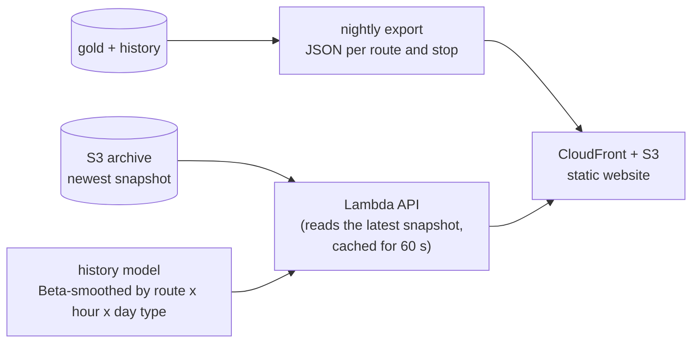

# Roadmap: from working pipeline to production service

**Written:** 18 November 2026, after Sprint 5's cloud deployment. **Status:** proposal; nothing in
it is built yet. Approve phases one at a time.

This treats Ghost Bus Radar as a client project: what a reviewer would flag before calling it
production, and what would make it stand out. Every step has the value it adds, a test for "done",
the expected cost and the effort. Steps marked **(you)** need the owner.

## Where it stands (audit, 18 November)

| Area | Status | Gap a client reviewer would flag |
|---|---|---|
| Collection | AWS Lambda every minute since 18 Nov; alarm on gaps | none urgent |
| Batch | Nightly Glue to S3 Tables; Athena; failure emails | no data-quality checks on the output; no "did tonight's numbers look normal?" report |
| Streaming | Laptop only; exactly-once proved | not in the cloud (Free plan blocks MSK; ADR-0009) |
| Code | 163 tests, CI defined | **Git repository with zero commits and no remote.** CI has never run. Everything lives only in a OneDrive folder |
| Security | Least-privilege roles; key in SSM | no CloudTrail trail; buckets don't refuse plain HTTP; the CLI access key is long-lived with no MFA and no rotation plan |
| Data | Collected since 15 Nov 19:31 (about 2.6 days); 16 and 17 Nov only about a third complete (laptop slept), cloud-complete from 18 Nov 07:29 | field check not done; no full weekday yet; the open S2 measurement (unmatched ids around a timetable change) is now possible: versions changed 16 and 17 Nov |
| Storage | 617 MB archive | 82% is the nightly timetable zip (505 MB): about 4 GB a month for files that barely change |
| Account | Free plan, $140 credits | **the account closes on 17 May 2027 unless upgraded**; EMR and MSK need the Paid plan |
| Product | none yet | no API, website, dashboard or public numbers: the brief's "something people can use" is still open |

## Phase 0: Safeguard what exists (this week)

**Status, 18 November:** 0.1 to 0.5 done. Code on GitHub (`IronNathanAlvares/ghost-bus-radar`) with CI
green (unit 20 s, Terraform 44 s, Docker integration and chaos 11 min); bucket guardrails and
CloudTrail live and tested; rotation documented (next 15 Feb 2027); both overdue measurements
recorded, one of which found the issue fixed as 1.0 (275 outcomes on 15 Nov corrected, all to `RAN`;
unmatched ids 0.00%). **0.6, the field check, is still open (owner).**

| # | Step | Why | Done when | Cost | Effort |
|---|---|---|---|---|---|
| 0.1 | **First commit and a GitHub repository (you: name and visibility)** | One disk failure or OneDrive sync conflict from losing weeks of work; a portfolio needs a public history | `main` pushed, CI green on GitHub (checks, terraform, integration) | free | 1 h |
| 0.2 | Bucket policies: deny non-TLS, deny deletes of `raw/` except by an explicit break-glass role | The archive is the system of record; protect it from mistakes as well as attackers | a plain-HTTP request and a `DeleteObject` from the admin user are refused | free | 1 h |
| 0.3 | CloudTrail trail (management events) into its own bucket | Who changed what, for longer than the 90-day console history | trail logging; Terraform-managed | about $0 (first trail free) | 30 min |
| 0.4 | Access-key hygiene: 90-day rotation reminder; `aws login` instead of a stored key if AWS ever allows console access for the user | A long-lived admin key on a laptop is the biggest credential risk | documented rotation; budget/CloudTrail alert on unusual API use | free | 30 min |
| 0.5 | Overdue measurements: 72-hour collection uptime (now from both archives) and the S2 "unmatched ids around a version change" | Both promised in SPRINTS; the second is a headline robustness claim | `docs/measurements/01` and `02` updated with numbers | about $0.05 | 1 h |
| 0.6 | **Field check: about 50 departures at 2 or 3 stops (you)** | The single biggest credibility boost: how often "untracked" buses really came | `field_check` report in `docs/measurements` | bus fare | 2 h at a stop |

## Phase 1: Numbers a client can trust (weeks 1 to 2, while data accumulates)

| # | Step | Why | Done when | Cost | Effort |
|---|---|---|---|---|---|
| 1.0 | **Done 18 Nov.** **Fix: realtime ids lag a timetable publish** (found by 0.5): if a `trip_id` is not in the live version, try the previous one for a few hours after a publish | 15,709 trip updates (0.96%) were unmatched in a 75-minute window after the 15 Nov republish; their trips could be called ghosts without their evidence | unmatched rate 0.00% across all four versions; reconcile 15 to 16 Nov re-run and the number of changed outcomes recorded | cents | half a day |
| 1.1 | **Done 18 Nov.** **Data-quality gates in the nightly job**: trips decided vs scheduled, `NO_DATA` share, unmatched-id rate, collection completeness; fail loudly or flag the day | A wrong number published is worse than a late one. Today a silently bad night (like the 7,003-trip day) would only be caught by a human | each night writes `gold.data_quality`; a breach emails; a test injects a bad day and sees the alert | cents | 1 day |
| 1.2 | **Done 18 Nov** (owner must confirm the SNS email). **Nightly summary email**: yesterday's trips, ran / untracked / cancelled with intervals, completeness, cost | Turns monitoring into a habit; the client sees the product working daily | one email per night at about 05:00 UTC | free (SNS email) | half a day |
| 1.3 | Collection SLOs and a CloudWatch dashboard: completeness ≥ 99% of minutes, gold ready by 06:00 UTC, 0 failed nights a week | Explicit targets are what "production" means | dashboard in Terraform; SLO numbers in the weekly report | free (3 dashboards included) | half a day |
| 1.4 | Prediction accuracy: compare `stop_time_predictions` with when buses actually reached stops | New, passenger-relevant metric: "when the board says 5 minutes, how long is it really?" | error by lead time and operator, with intervals | cents | 2 days |
| 1.5 | Weekly league table with **significance tests** (and correction for testing 250 routes) | Avoids the classic trap of ranking noise; a client can quote it safely | weekly Athena view + Markdown report; routes flagged only when the difference is significant | cents | 1 day |
| 1.6 | Storage tidy-up: keep every static zip whose content differs, but store unchanged nightly re-uploads as a manifest pointing to the previous zip | 4 GB a month of near-duplicates; small cost now, but the principle (content-addressed, deduplicated) is a good design story | archive growth drops to about 110 MB/day; no loss of information (hash proves equality) | saves about $1/month at a year | half a day |

## Phase 2: The product (weeks 2 to 4)

The original brief asks for "something people can use". The cheapest robust design, given the
Free plan, needs no streaming in the cloud at all:

| # | Step | Why | Done when | Cost | Effort |
|---|---|---|---|---|---|
| 2.1 | **Done 18 Nov** (ADR-0011). Nightly JSON export (per route, per stop, league table) | The website works even if every compute part is off | JSON files in S3 after each nightly run | cents | 1 day |
| 2.2 | **Done 18 Nov** (ADR-0013). Static website on CloudFront + S3: league table, route pages, stop lookup, heatmaps, methodology, NTA attribution **(you: own domain or not)** | The public face of the project | live URL; Lighthouse score ≥ 90; methodology page links every number to its definition | about $0-1/month | 1 week |
| 2.3 | **Done 18 Nov** (ADR-0012). **"Will my bus come?" API**: for a stop, upcoming departures with a probability that each one shows up | The headline feature; live **without** streaming: the API reads the newest archived snapshot (written every minute anyway) | `GET /v1/stops/{code}/departures` p95 < 500 ms; probability from history plus live signals (vehicle assigned? tracked? cancelled?) | Lambda + API Gateway free tier | 1 week |
| 2.4 | **Done 18 Nov** (ADR-0014, measurement 08). **v2 19 Nov** (ADR-0015, measurement 09): hierarchical empirical Bayes and per-operator cancellations; beats both baselines. Calibration on held-out days: Brier score and a reliability diagram, against an "always comes" baseline | The difference between a guess and a model; shown on the methodology page | Brier score beats the baseline, chart published | cents | 2 days |
| 2.5 | BI dashboard **(you: Power BI or Tableau)** over Athena views | Analysts and interviewers expect one | `.pbix` + screenshots in the repo | free (Desktop) | 2 days |

## Phase 3: What makes it stand out

Pick two or three; each is a strong portfolio or press story on its own.

| # | Idea | What it shows | Data needed | Effort |
|---|---|---|---|---|
| 3.1 | **Unannounced disruption detector**: spot a route where ghosts or cancellations cluster within an hour, and check whether the Alerts feed said anything | Real-time anomaly detection; a public-accountability angle ("silent disruptions") | already collected (alerts feed every 15 min) | 3 days |
| 3.2 | **Equity analysis**: ghost rates by the deprivation level of the area a stop serves (Pobal HP Deprivation Index, CSO small areas) | Are poorer areas served worse? A civic story with clear method and caveats | open data, joined by stop location | 3 days |
| 3.3 | Weather and events: ghost rates against Met Éireann rain and wind, school terms, match days | Explains variation instead of only measuring it | open data (Met Éireann API) | 2 days |
| 3.4 | **Ask the data in plain English**: a Claude-powered page that turns questions into read-only Athena SQL in the 1 GB-capped workgroup, shows the SQL and the answer | Modern, practical LLM use with guardrails (read-only role, scan cap, SQL shown) | the lake as it is | 3 days; about $1-5/month at low use |
| 3.5 | Open dataset: weekly Parquet + CSV of trip outcomes with a data dictionary, licence and DOI-style versioning | Reuse by journalists and researchers; shows data-product thinking | the lake | 1 day |
| 3.6 | Board honesty score per stop: share of "live" countdowns that ended in no bus (`PHANTOM_LIVE`) | A passenger-facing metric nobody else publishes | already computed | 1 day |
| 3.7 | Before/after the NTA's Trapeze AVL pilot, if it starts on any route | Natural experiment; difference-in-differences against unaffected routes | needs the pilot to start | 2 days |

## Phase 4: Production operations (when the product is public)

| # | Step | Why | Done when | Cost | Effort |
|---|---|---|---|---|---|
| 4.1 | **Upgrade to the Paid plan with a spend limit (you)**, before 17 May 2027 | Avoid account closure; unlocks EMR Serverless and MSK; the spend limit keeps the "cannot overspend" property | upgraded; spend limit set at, say, $25/month | pay-as-you-go | 15 min |
| 4.2 | Separate dev and prod accounts (new-experience "projects") | Never test against the live archive again (a lesson from Sprint 4's leaked fixture) | `envs/dev` and `envs/prod` Terraform; CI deploys to dev | free | 1 day |
| 4.3 | Deploy from CI with GitHub OIDC (no stored AWS keys): plan on pull request, apply on merge with approval | Repeatable, reviewable deploys; removes the laptop as a single point of failure | a merged PR deploys; no AWS keys in GitHub | free | 1 day |
| 4.4 | **Done 18 Nov** (plus threat model, hash-chained archive, tripwires; `docs/07-security.md`). Security scanning in CI: `tflint`, `checkov` (IaC), `pip-audit` (dependencies), secret scanning | Catches misconfigurations before they ship | CI fails on high findings | free | half a day |
| 4.5 | Runbooks: NTA outage vs our outage, key revoked, Glue failure, backfill, restore from archive | Someone else can operate it at 3 am | each runbook tested once | free | 1 day |
| 4.6 | Streaming burst in the cloud (after 4.1): MSK + EMR Serverless for an afternoon, replaying the archive; measure latency; destroy | Completes the brief's Kafka/MSK + EMR story with a dated, real cloud latency number | measurement doc; total cost under $5 | about $3-5 once | 2 days |
| 4.7 | Load test the API (k6), and a cost report from Cost Explorer per mode | Proves the "few dollars a month" claim under load | p95 under target at 50 req/s; monthly cost table | cents | 1 day |

## Phase 5: Tell the story

| # | Step | Done when |
|---|---|---|
| 5.1 | README rewrite: headline numbers with intervals, architecture diagram, "how to run", limits | a reviewer understands it in 5 minutes |
| 5.2 | 3-minute demo video (stop lookup, league table, a bug story) | linked from README |
| 5.3 | Write-up post: "What I learned measuring ghost buses" | published (you choose where) |
| 5.4 | Interview pack: the diagrams (done) plus a one-page "decisions and trade-offs" sheet | in `docs/` |

## Decisions needed from you

1. **GitHub repository name, and public or private** (blocks 0.1). Suggestion: `ghost-bus-radar`,
   private until the field check is done, then public.
2. **Field check date** (0.6). A weekday peak: 07:30 to 09:30 or 16:30 to 18:30.
3. **Power BI or Tableau** (2.5). Recommendation: Power BI Desktop (free, native Athena connector).
4. **Website domain**: a CloudFront address is free; a custom domain is about $15 a year (2.2).
5. **Which two or three Phase 3 ideas.** Recommendation: 3.1 (silent disruptions), 3.6 (board
   honesty) and 3.4 (plain-English questions): new, cheap, and each one a strong story.
6. **When to upgrade to the Paid plan** (4.1). Recommendation: when the website goes public, with a
   spend limit.

## Suggested order

0.1 → 0.2 → 0.3 → 0.5 → 1.1 → 1.2 → 2.1 → 2.3 → 2.2 → 2.4 → 1.4 → chosen Phase 3 ideas → Phase 4 →
Phase 5. The field check (0.6) any weekday the owner can, the sooner the better.
