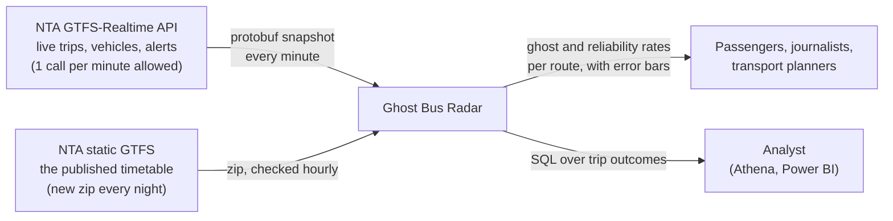
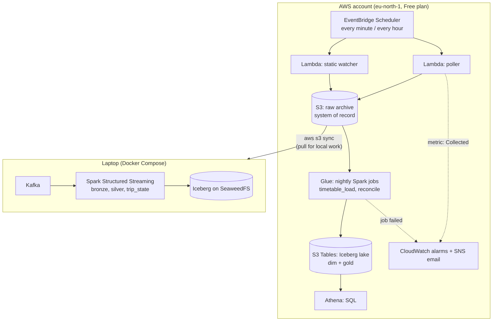
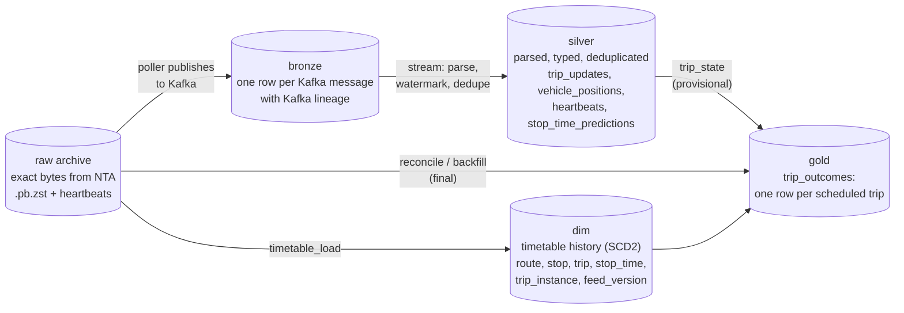

# 1. The big picture

Start any presentation here. These three diagrams answer "what is it, where does it run, and how
does data flow", and every later diagram zooms into one box from them.

## 1.1 What the system does (context)

**Say it in one breath:** every minute we save what Ireland's live bus feeds say, compare it with
the published timetable, and decide for every scheduled trip whether a bus really came, so we can
publish honest reliability numbers.

**Walk through it**
1. Two inputs, both from Ireland's National Transport Authority (NTA): the **realtime** feed (what
   buses are doing now) and the **static** timetable (what was promised).
2. The system's job is to join them: promised trips against observed trips.
3. The outputs are numbers people can trust: rates with confidence intervals, never a single scary
   number.

**Interviewer asks**
- *Why not just count trips that were missing from the realtime feed?* Because "not tracked" is not
  "did not run": a bus with a broken tracker still carries passengers. We separate outcomes
  (cancelled, ran, vanished, untracked) and run a field check to measure how often "untracked"
  buses actually came.
- *What is your rate limit and how did it shape the design?* One call per minute for the whole API
  key. So the three feeds share that minute (ADR-0005), and each feed refreshes every two minutes.

## 1.2 Where everything runs today

**Say it in one breath:** collection and the nightly batch run in AWS for a few dollars a month;
the streaming pipeline (Kafka and Spark) runs on the laptop, where it is free.

**Walk through it**
1. Top half is always on and cheap: two small functions (Lambda) triggered by a clock (EventBridge
   Scheduler) write raw data to S3.
2. Once a night, Glue (managed Spark) turns the raw archive into clean tables, which Athena queries
   with SQL.
3. Bottom half is the streaming demo: the same code, in Docker, fed from the archive.

**Interviewer asks**
- *Why not stream in the cloud too?* Cost and account rules. Kafka (MSK) plus always-on Spark is
  about $200 a month; the account's Free plan blocks MSK and EMR anyway. Because the archive is the
  source of truth, the batch path produces exactly the same final outcomes (proved row for row in
  Sprint 4), so streaming in the cloud is a "burst for a demo" feature, not a requirement
  (ADR-0009).
- *What happens if the laptop is off?* Nothing is lost: collection is in AWS since 18 November.

## 1.3 Data layers (raw, bronze, silver, gold)

**Say it in one breath:** data gets cleaner at each layer, and every layer can be rebuilt from the
one before it, all the way back to the raw archive.

**Walk through it**
1. **Raw** is never changed: if any later step has a bug, we fix the code and recompute.
2. **Bronze** is "what Kafka delivered", **silver** is "what it means", **gold** is "the answer".
3. Gold can be written two ways, live (from silver) and final (from raw), by the same code; the
   final one always wins.

**Interviewer asks**
- *This is the medallion architecture. Why keep a raw layer in front of bronze?* Kafka keeps data
  for 7 days; the archive keeps it forever, costs about $0.08 a month per month of data, and lets
  us replay any outage (ADR-0001).
- *How do you know the two paths to gold agree?* `backfill_demo` computes outcomes from the stream
  and from the archive and compares every column of every row: 0 differences on 10,528 trips.

**Beginner notes**
- **S3**: AWS's file storage. **Bucket**: a top-level folder with its own name.
- **Iceberg**: a table format on top of files that gives databases' guarantees (atomic commits,
  schema changes, time travel) to plain Parquet files.
- **Lambda**: run a function without a server; you pay per millisecond it runs.
- **Glue**: AWS-managed Spark; you pay only while a job runs.
