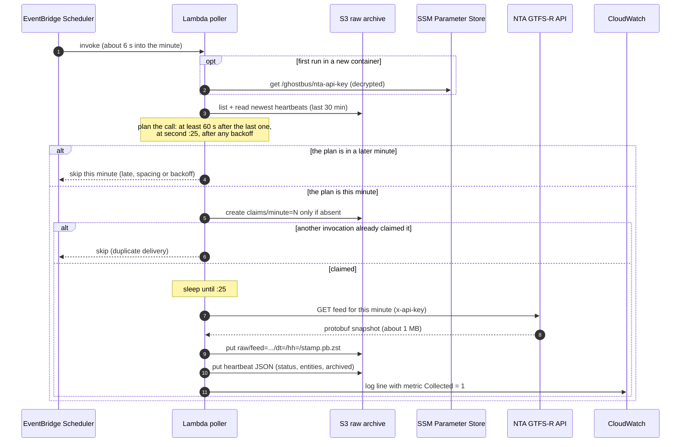
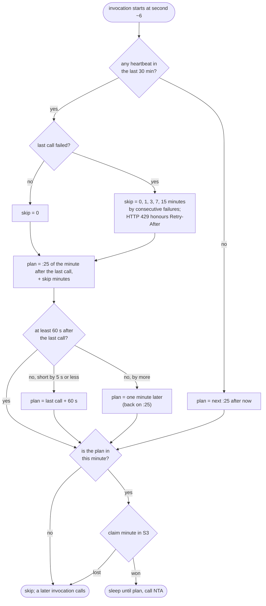
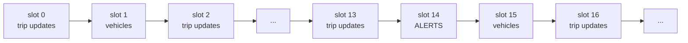
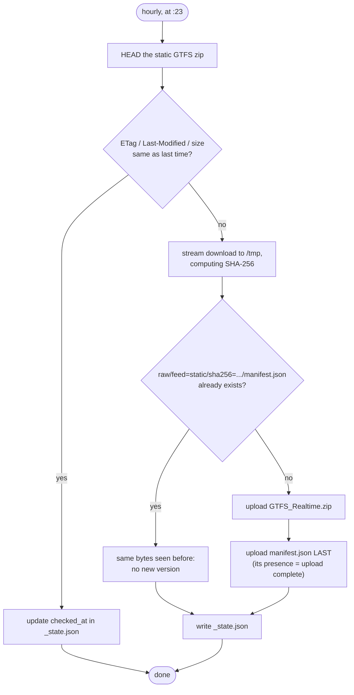
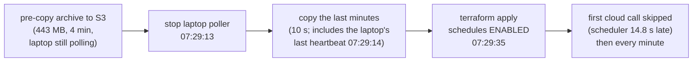

# 2. Collection: one API call a minute, never lost

How raw data gets in. This is the part with the hardest rule (one call per minute for the whole
key) and the most interesting reliability questions.

## 2.1 One minute in the life of the cloud poller

**Say it in one breath:** a scheduler wakes a function every minute; the function works out from
the archive whether it may call, claims the minute so nobody else can, calls NTA at second :25,
saves the exact bytes, then writes a heartbeat that records how the call went.

**Walk through it**
1. The scheduler fires at the start of each minute. The function has no memory, so it reads the
   last half hour of heartbeats to know when the key last called and whether it is backing off.
2. It computes the planned call time with the same pure function the laptop poller uses.
3. It claims the minute with an S3 conditional write (`If-None-Match: *`). Only one writer can
   create the same object, so even two copies of the same trigger cannot both call.
4. Archive first, heartbeat last: a snapshot only counts as "collected" once it is safely in S3.

**Interviewer asks**
- *EventBridge is at-least-once. How do you avoid calling twice?* The S3 conditional write is a
  distributed lock with one winner per minute. The usual alternative, reserved concurrency of 1,
  is often unavailable on new accounts.
- *Why read heartbeats instead of keeping state in DynamoDB?* The heartbeats already have to exist
  (they decide `NO_DATA`), and they also hold the laptop's last call, so the 60 s rule held across
  the move from laptop to cloud with no extra service.
- *Why sleep inside a Lambda? Isn't that paying for nothing?* About 20 s at 256 MB a minute is
  about 216,000 GB-seconds a month, inside the 400,000 always-free allowance. A second scheduler
  just to hit :25 would be more moving parts for no saving.
- *How do you know it's working?* Every collected call logs a CloudWatch metric; an alarm emails
  if fewer than one arrives in 10 minutes.

## 2.2 The pacing rules as a decision flow

**Say it in one breath:** never call twice in 60 seconds, back off after failures, land on the
chosen second, and skip a minute rather than call late.

**Interviewer asks**
- *Why no immediate retry on failure?* A retry is a second call in the same minute, which breaks
  the limit. A failed minute is simply a missed snapshot, recorded in its heartbeat.
- *You mentioned a bug here.* Yes: the old plan was "max(offset, last + 60 s)", which locked calls
  on whatever second they first happened at, so moving the offset to :25 had no effect. Found when
  watching the live logs, fixed with the realign rule above, covered by property tests, verified
  live: 07:42:15, then 07:43:25, then every minute at :25.

## 2.3 Which feed each minute

**Say it in one breath:** minute slots alternate between trip updates and vehicle positions, and
one minute in fifteen goes to alerts, so each main feed refreshes every two minutes.

- The rule is a pure function of the clock (`feeds.feed_for_slot`), so the laptop and the Lambda
  pick the same feed for the same minute, and no state is needed.
- The alternation counts only non-alert slots, so neither main feed ever waits more than three
  minutes. An early version left a four-minute gap; a property test caught it.

## 2.4 The static timetable watcher

**Say it in one breath:** every hour, ask NTA whether the timetable file changed (a cheap HEAD
request); if it did, download it, fingerprint it, and store it once under its fingerprint.

**Interviewer asks**
- *Why the SHA-256 and not the file name or date?* Content addressing: identical bytes are stored
  once, and the key proves what is inside. NTA re-uploads every night, sometimes with a new
  timetable version, sometimes with the same one.
- *Why write the manifest last?* It acts as a commit marker. A crash halfway leaves a zip without
  a manifest, which readers ignore and the next run completes.

## 2.5 Cutover: moving the poller from laptop to cloud

**Say it in one breath:** copy the bulk of the archive while the laptop still polls, stop the
laptop, copy the last few files, switch the cloud on, all inside one minute.

**Interviewer asks**
- *How did you keep the one-call-per-minute rule during the switch?* Only one poller existed at any
  moment, and because the laptop's last heartbeat was in S3 before the Lambda started, the Lambda
  knew exactly when the last call was.
- *What did it cost in data?* About two minutes of `NO_DATA`, which the outcome rules handle
  honestly (never as ghosts).

**Beginner notes**
- **EventBridge Scheduler**: AWS's cron. **At-least-once delivery**: it may occasionally deliver
  the same trigger twice, so receivers must be idempotent.
- **SSM Parameter Store**: a free key-value store for configuration and secrets (SecureString is
  encrypted with KMS).
- **Conditional write**: "create this object only if it does not exist yet". S3 rejects the second
  writer with HTTP 412.
- **Protobuf**: Google's compact binary format; GTFS-Realtime is defined in it.
