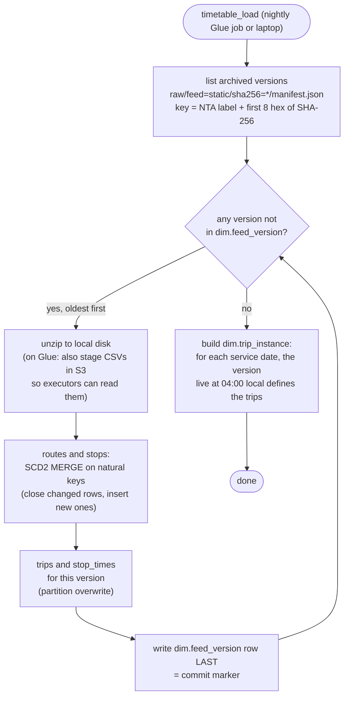
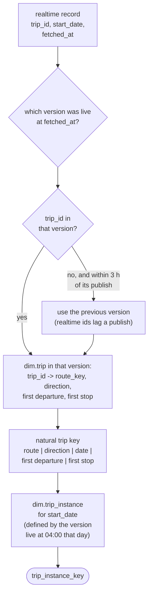
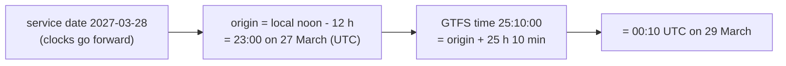
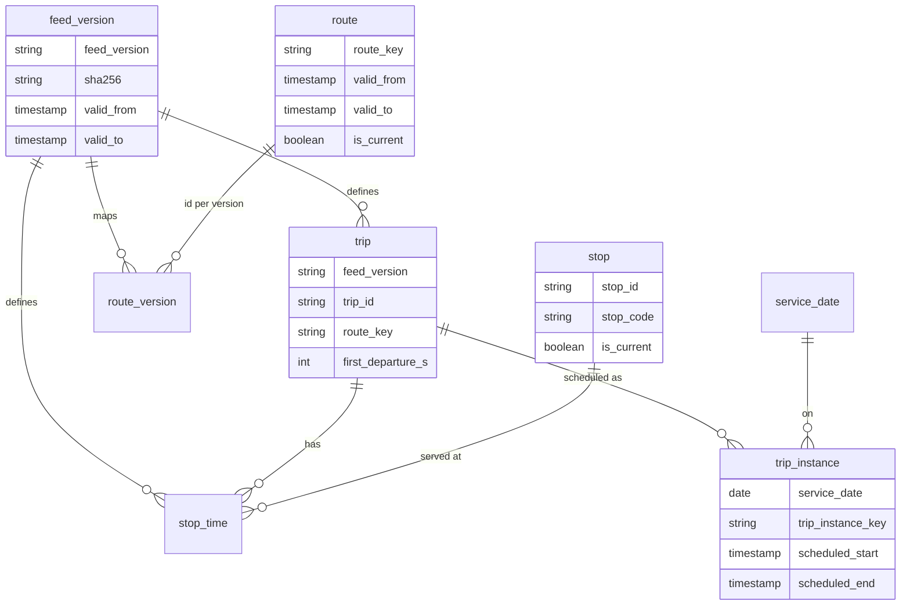

# 3. The timetable: what was promised, with history

Realtime data is only meaningful against the schedule that was in force at the time. These
diagrams explain how the timetable is stored with history (SCD2) and how a live trip finds its
scheduled trip even when the timetable changed that day.

## 3.1 Loading a new timetable version

**Say it in one breath:** each archived timetable zip becomes a version; routes and stops are
merged as history (type 2 slowly changing dimensions), trips and stop times are stored per
version, every scheduled trip of every day becomes one row, and the version is marked loaded
only at the very end.

**Walk through it**
1. A version is one archived zip, keyed by NTA's label plus the start of its SHA-256, and becomes
   valid from the time NTA published it. The label alone is not unique: NTA re-uploads nightly,
   sometimes with the same label and different contents.
2. Routes and stops change rarely, so they keep history: each row has `valid_from` / `valid_to`
   and an `is_current` flag (SCD2).
3. Trips and stop times are large and change wholesale, so they are stored per version.
4. The `feed_version` row is written last. If the job dies halfway, the version is simply not
   marked loaded and the next run redoes it; every step is idempotent.

**Interviewer asks**
- *What is SCD2 and why use it here?* A slowly changing dimension of type 2 keeps every past state
  of a row with validity dates, instead of overwriting it. A trip on 15 November must be judged
  against the stops and route as they were on 15 November.
- *How do you make a multi-step load safe to rerun?* MERGE (upsert) on natural keys, partition
  overwrite for per-version tables, and a commit marker written last. Rerunning gives the same
  result, which also made it safe to retry on a flaky local disk.
- *What did loading real history in the cloud reveal?* Two zips with the same label but different
  calendars. Keyed by label, the second overwrote the first's trips, and 15 November lost 5,182 of
  its 12,185 trips. The laptop never saw it because it had loaded only one version. Fix: a unique
  version key; a regression test reproduces the republish and fails on the old code.
- *What broke on the first cloud run?* The job unzipped files to the driver's `/tmp` and asked
  Spark to read `file:/tmp/...`. On the laptop Spark is one machine; on Glue the executors are
  other machines and could not see the file. Fix: stage the CSVs in S3 when `STATIC_STAGE_URI` is
  set. A classic local-versus-cluster bug.

## 3.2 Matching a live trip to its scheduled trip

**Say it in one breath:** NTA's trip ids can change with every timetable upload, so a live
record is first translated to a stable natural key using the timetable that was live when it was
fetched, and that key then finds the scheduled trip on its service day.

**Interviewer asks**
- *Why not join on `trip_id`?* NTA regenerates ids per upload. A live record fetched after a new
  upload carries a new id, while the day's scheduled trips came from the older version. The
  natural key (route, direction, date, first departure time, first stop) is the same in both.
- *How well does it match?* 0.00% unmatched over 49,344 realtime trips in Sprint 2, with one
  version. Across four versions, 0.96% were unmatched, all in the 75 minutes after one publish:
  NTA's live feed kept the previous zip's ids for 76 minutes. With a 3-hour fallback to the
  previous version, 0.00% again over 1.6 million trip updates.
- *Couldn't a fallback attach a record to the wrong trip?* Ids are regenerated with every zip, so
  an id found only in the previous version belongs to it. The window is short (3 hours) and the
  rule is pure, unit-tested, and mirrored exactly in Spark.

## 3.3 GTFS time is not clock time

**Say it in one breath:** GTFS times count from noon minus twelve hours on the service date, so a
trip at "25:10:00" runs at 01:10 the next morning, and on clock-change days the origin is not
midnight.

- Never compute "midnight + seconds". The code converts with `timetable.gtfs_time_to_utc`, and
  tests cover both clock-change days.

## 3.4 The timetable tables

**Beginner notes**
- **GTFS**: the standard format for public transport timetables (CSV files in a zip).
- **Natural key**: an identifier built from real-world attributes, as opposed to a generated id.
- **MERGE**: SQL's upsert: update rows that match, insert those that don't.
- **Driver and executors**: in Spark, the driver plans the work and executors (often other
  machines) do it; anything executors read must be reachable from every machine.
