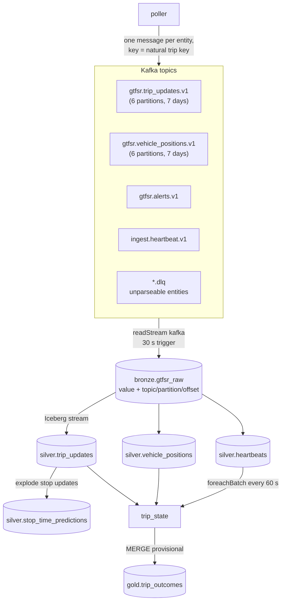
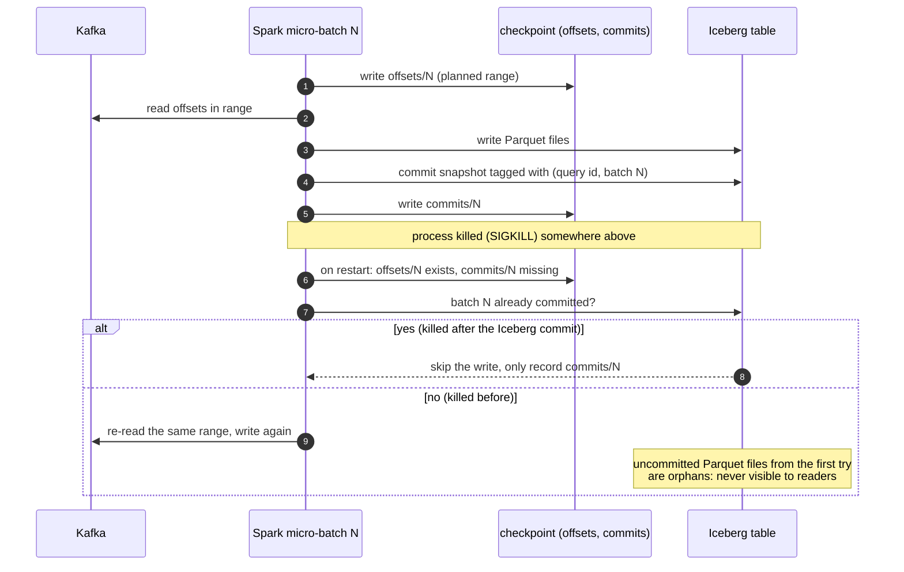
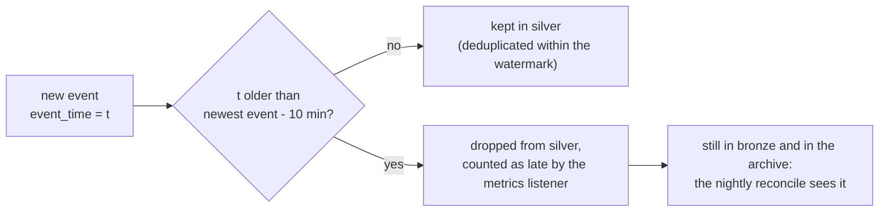

# 4. Streaming: Kafka to Iceberg, exactly once

The local streaming pipeline (Docker Compose). Interviewers love this part: delivery guarantees,
late data and what happens when a process is killed mid-write.

## 4.1 The streaming pipeline

**Say it in one breath:** the poller publishes every entity to Kafka; Spark copies messages
as-is into a bronze table, then parses, deduplicates and splits them into silver tables, and a
separate job turns silver into provisional trip outcomes every minute.

**Walk through it**
1. **Kafka** decouples collection from processing: if Spark is down, messages wait (7 days).
2. **Bronze** stores exactly what Kafka delivered plus its coordinates (topic, partition, offset),
   so any row can be traced to one message.
3. **Silver** parses JSON into typed columns, assigns event time, drops duplicates and stale
   repeats, and drops events more than 10 minutes late (they are still in bronze and the archive).
4. **trip_state** decides each trip a few minutes after it closes and writes a provisional outcome.

**Interviewer asks**
- *Why is the Kafka key the natural trip key?* All messages for one trip land in the same
  partition, so they stay in order relative to each other.
- *What is a dead-letter queue for?* An entity that fails to parse goes to `*.dlq` with the error,
  instead of failing the whole snapshot or vanishing silently.
- *Why bronze and silver as separate streams?* Bronze is cheap and never wrong (no parsing), so a
  parsing bug never loses data: fix the code and rebuild silver from bronze.

## 4.2 Exactly once, even when killed

**Say it in one breath:** Spark remembers which Kafka offsets each micro-batch read in a
checkpoint, Iceberg remembers which batches it already committed, and duplicates that arrive
anyway (replays, retries) are removed by key, so a crash at any moment produces no missing and no
duplicate rows.

**Walk through it**
1. Before a batch, Spark writes the planned offset range; after it, a commit marker.
2. Iceberg's commit is atomic and records the batch id, so a replayed batch is recognised and
   skipped.
3. The proof is a chaos test: the whole pipeline was killed with SIGKILL 20 times (16 of them
   mid-batch), and every table matched an uninterrupted run row for row: 0 duplicates, 0 missing.

**Interviewer asks**
- *Is Kafka itself exactly once here?* The producer is idempotent (`enable.idempotence`,
  `acks=all`), so retries never duplicate inside Kafka. End to end, exactly-once comes from
  checkpoint plus idempotent sink plus dedupe, not from Kafka alone.
- *What are orphan files and are they a problem?* Files written but never committed. Readers never
  see them; they only cost storage, and Iceberg's maintenance removes them.

## 4.3 Event time, watermarks and late data

**Say it in one breath:** each row carries the time the event happened; the watermark trails the
newest event by 10 minutes, and anything older than the watermark is counted and dropped from the
stream (but kept in bronze and the archive for the nightly reconcile).

**Interviewer asks**
- *Why 10 minutes?* Vehicle positions can be repeated stale for up to about 28 minutes, but
  realtime decisions only need fresh data, and the final outcome comes from the archive anyway, so
  a short watermark keeps state small without losing anything that matters.
- *What did latency look like?* Fetch to bronze 16 s, fetch to silver 46 s (p50 and p95), set by
  the 30 s trigger phase rather than by load.

**Beginner notes**
- **Kafka topic / partition / offset**: a named log, split into ordered shards, with each message
  numbered by its position.
- **Micro-batch**: Structured Streaming processes new data in small batches on a timer (trigger).
- **Watermark**: how long to wait for late events before treating a time window as complete.
- **Idempotent**: doing it twice has the same effect as doing it once.
