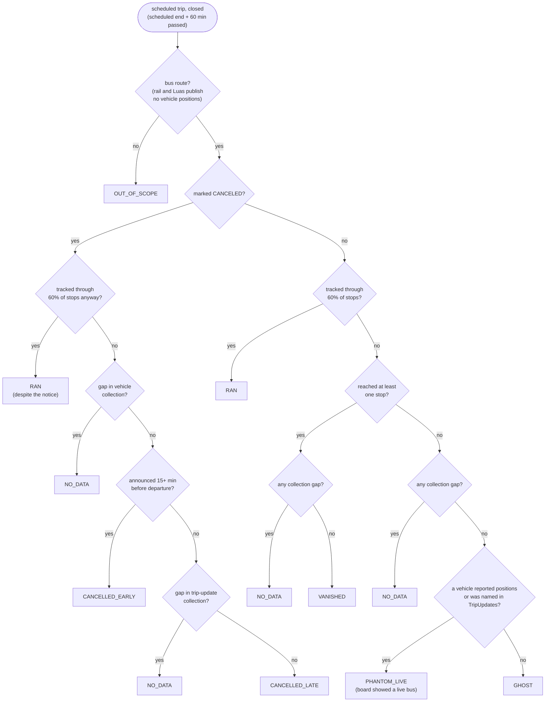
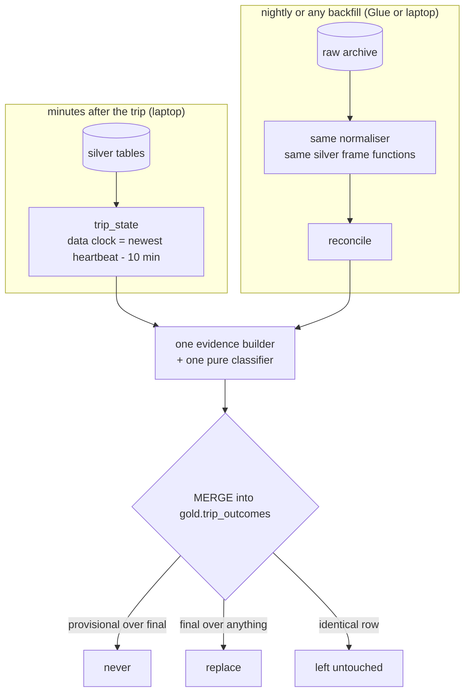
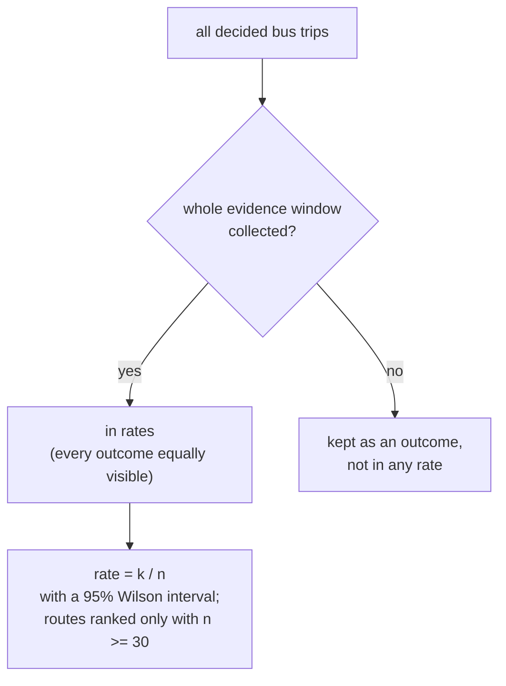
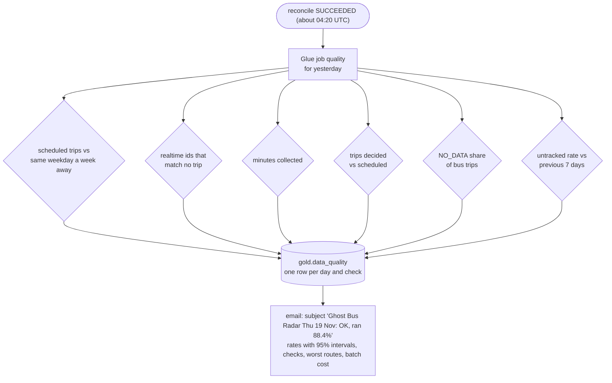

# 5. Outcomes: what happened to each scheduled trip

The heart of the project: turning raw observations into one honest answer per trip, and
publishing rates that cannot be fooled by our own downtime.

## 5.1 The outcome classifier

**Say it in one breath:** for each scheduled bus trip we gather evidence (snapshots,
cancellation time, vehicle positions, how far along the route it got, gaps in our own collection)
and run fixed rules in order; anything our downtime could explain becomes `NO_DATA`, never a
ghost.

**Walk through it**
1. **Progress comes from geometry**: NTA positions carry no stop sequence, so progress is the
   furthest stop on the trip that any position came within 250 m of.
2. **Only a bus tracked to the end survives a gap.** Every "it didn't come" outcome needs our
   collection to have been complete for the trip's whole window (30 min before to 30 min after).
3. "Untracked" in headlines = `GHOST` + `PHANTOM_LIVE`.

**Interviewer asks**
- *How do you know the rules don't blame your own outages on buses?* A property test (Hypothesis)
  generates random evidence and checks that a collection gap can never produce `GHOST`,
  `PHANTOM_LIVE` or `VANISHED`, and that closing a gap only ever makes an outcome more specific.
- *Where did the rules come from?* Each change was found by a test or the data: a property test
  (`VANISHED` needs both feeds), a real bus parked 1 km off route (`PHANTOM_LIVE`), the outage demo
  (a cancellation needs vehicle coverage), and a full-row comparison (evidence stops at close time).
  Every outcome row stores its rules version.

## 5.2 Collection gaps become NO_DATA

**Say it in one breath:** heartbeats record every call; more than 5 minutes between two collected
snapshots of a feed is a gap, and a trip whose evidence window overlaps a gap cannot be called a
ghost.

```mermaid
gantt
    title One trip and our own collection
    dateFormat HH:mm
    axisFormat %H:%M
    section Trip
    evidence window (dep - 30 to end + 30) :w, 20:00, 100m
    scheduled trip                         :t, 20:30, 40m
    section Vehicles feed
    collected                              :a1, 20:00, 45m
    GAP (no snapshot > 5 min)              :crit, g1, 20:45, 20m
    collected                              :a2, 21:05, 35m
```

- Here the vehicles feed has a hole during the trip, so unless the bus was tracked to the end,
  the trip is `NO_DATA` and is excluded from every rate.

## 5.3 Provisional, final and backfill

**Say it in one breath:** the stream gives a provisional answer minutes after each trip closes;
every night the batch recomputes the final answer from the raw archive with the same code, and
final always replaces provisional, never the other way round.

**Walk through it**
1. Both paths build silver-shaped tables and call the same evidence builder and the same
   classifier, so "same logic live and in backfill" is enforced by construction, not by promise.
2. A backfill is just `reconcile` over a date range: any outage of Kafka or Spark is repaired
   from the archive.

**Interviewer asks**
- *How did you prove backfill equals live?* `backfill_demo` computes the same closed trips three
  ways: from silver, from silver with a one-hour hole punched in it, and from the archive. Result:
  archive = uninterrupted on every column of 10,528 trips; the hole turned 436 trips into
  `NO_DATA` and none into ghosts.
- *What did the stricter comparison find?* Comparing all evidence columns, not just outcomes, found
  15 differing rows. Two causes: test data had leaked into the live tables, and evidence was
  counted up to "now", so a late bus gave different counts depending on when you looked. Both fixed.

## 5.4 Which trips count in published rates

**Say it in one breath:** rates use only bus trips whose whole window we collected, chosen by
coverage and never by outcome, because across a gap good news survives and bad news becomes
`NO_DATA`.

**Interviewer asks**
- *What bias did this fix?* Survivorship. Counting every decided trip gave 94.4% ran; counting only
  fully collected trips gave 87.2%. 1,040 trips had been decided "ran" through a gap, where a trip
  that did not run would have been `NO_DATA`.
- *Why a Wilson interval and not plus-or-minus 1.96 standard errors?* It stays inside 0 to 100%
  and behaves well with small samples and rates near zero, which is exactly where ghost rates live.

## 5.5 Nightly quality gates

**Say it in one breath:** after the nightly outcomes are written, six checks decide whether the
day's numbers can be trusted, the result is stored in `gold.data_quality`, and an email arrives
with OK, WARN or FAIL in its subject.

| Check | Fails when | The real incident it would have caught |
|---|---|---|
| scheduled vs a week away | off by more than 25% | 15 Nov had 7,003 scheduled trips against 12,184 the next Sunday (same-label timetable zips) |
| unmatched realtime ids | above 0.5% | 0.96% after the 15 Nov republish (realtime ids lagged the publish) |
| completeness | under 90% of minutes | the sleeping laptop: 471 of 1,440 minutes on 16 Nov |
| decided vs scheduled | under 99% | a reconcile that stops at the data clock |
| NO_DATA share | above 25% of bus trips | long collection gaps |
| untracked shift | (warns only) more than 2 points and outside the 95% interval | a real change in service, or a code change |

**Interviewer asks**
- *Why not just alert when the job fails?* The worst failures here never crashed anything: the
  7,003-trip day ran green end to end. Data checks catch what job monitoring cannot.
- *How did you choose the thresholds?* By replaying every real failure in a unit test: each must
  fail, and a healthy day must pass. One test caught that the first threshold (1%) would have
  missed the 0.96% bug.
- *Why compare with the same weekday a week away?* Timetables differ by day type (weekday,
  Saturday, Sunday); a week away is the closest like-for-like day, and the timetable is built 7
  days ahead, so the comparison always exists.

**Beginner notes**
- **Property-based testing**: instead of a few hand-picked examples, generate hundreds of random
  inputs and check a rule that must always hold.
- **Survivorship bias**: drawing conclusions only from what survived a filter.
- **Confidence interval**: a range that would contain the true rate 95% of the time.
