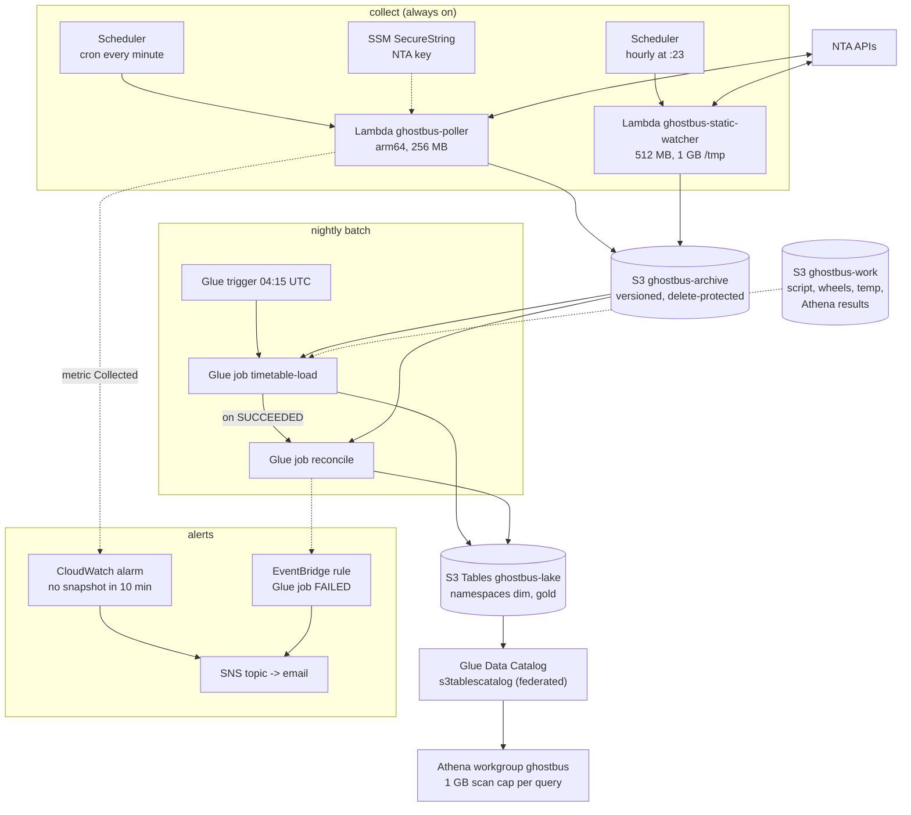
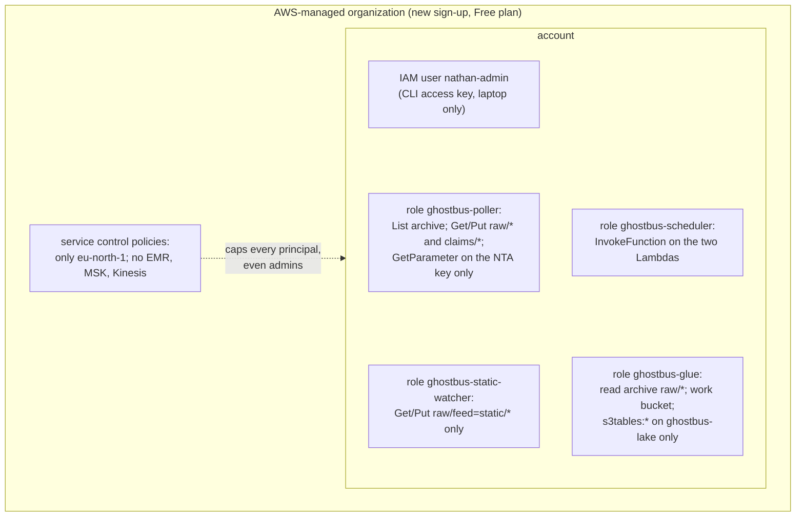
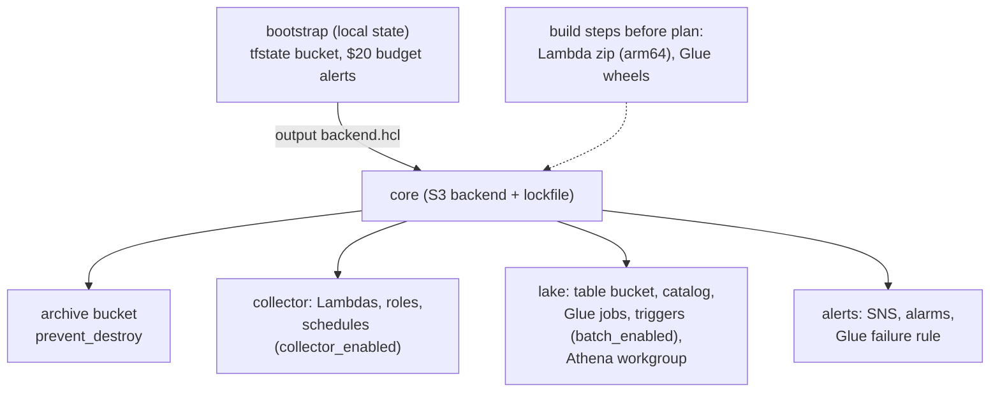
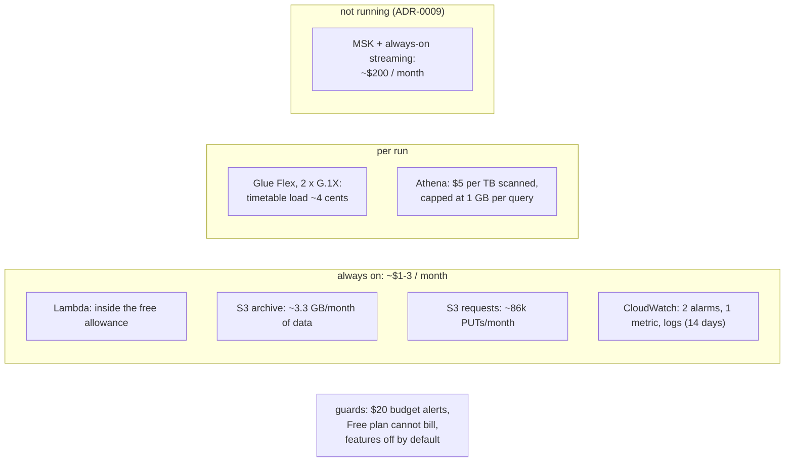

# 6. The cloud: AWS services, permissions, deployment and cost

What runs in AWS, who is allowed to do what, how it is deployed with Terraform, and how the bill
is kept to a few dollars.

## 6.1 AWS architecture (eu-north-1)

**Say it in one breath:** two schedules drive two Lambdas that fill an S3 archive; a nightly
Glue chain turns the archive into Iceberg tables in S3 Tables; Athena queries them through the
Glue Data Catalog; CloudWatch, EventBridge and SNS email when something breaks.

**Interviewer asks**
- *Why Lambda and not a small EC2 instance for the poller?* No server to patch, no idle cost, and
  the usage fits the always-free allowance. The trade-off is no memory between runs, solved by
  reading state from the archive.
- *Why Glue rather than EMR Serverless?* Both run the same Spark code. The account's Free plan
  denies EMR; Glue 5.1 matches the local Spark 3.5.6 / Iceberg 1.10 exactly (ADR-0010).
- *How does Athena see Iceberg tables in S3 Tables?* The table bucket is federated into the Glue
  Data Catalog as `s3tablescatalog`; Athena queries `"s3tablescatalog/ghostbus-lake".gold.trip_outcomes`.

## 6.2 Who may do what (least privilege)

**Say it in one breath:** every component has its own IAM role with only the actions it needs on
only its own resources, and the account itself sits inside AWS-managed guardrails.

**Interviewer asks**
- *Where is the NTA API key and who can read it?* In SSM as an encrypted SecureString. Only the
  poller role can read that one parameter. It never enters Terraform state: Terraform knows only
  its name, and a script copies it from `.env` without printing it.
- *What is a service control policy?* An organization-level limit that applies to every identity in
  the account, including administrators. The account's first deploy failed with "explicit deny in a
  service control policy"; the IAM policy simulator then mapped exactly which actions and regions
  were allowed, before writing any more Terraform.

## 6.3 Terraform layers and deploy order

**Say it in one breath:** a tiny bootstrap layer (state bucket and budget) is applied once with
local state; everything else lives in the core layer, whose state is stored in that bucket with
locking, and nothing switches on until a flag says so.

**Interviewer asks**
- *Why two layers?* Terraform needs somewhere to keep its state before it can create that place.
  The bootstrap layer creates the state bucket with local state; the core layer then uses it.
- *How do you avoid deploying something live by accident?* Features ship disabled behind variables
  (`collector_enabled`, `batch_enabled`), plans are read before every apply, and the irreplaceable
  archive has `prevent_destroy`.
- *How do you keep the Lambda package reproducible?* The build installs Linux arm64 wheels from the
  lock file and writes a zip with fixed timestamps: same inputs, same bytes, so Terraform only
  redeploys on real changes.

## 6.4 Where the money goes

**Say it in one breath:** collection costs about a dollar a month, the nightly batch a few cents a
run, and Kafka plus always-on Spark (about $200 a month) is deliberately not running in the cloud.

**Beginner notes**
- **IAM role**: a set of permissions a service assumes; no passwords or keys are stored in code.
- **Terraform state**: Terraform's record of what it created, compared with the code on every plan.
- **Flex execution**: Glue runs the job on spare capacity for about a third less, starting a little
  later.
- **Federated catalog**: a catalog entry that points at tables managed by another service.
