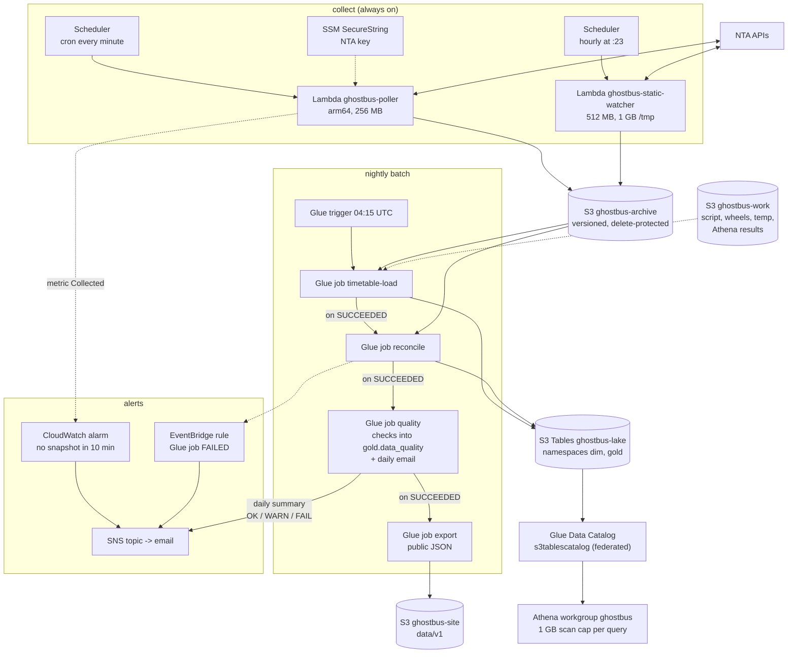
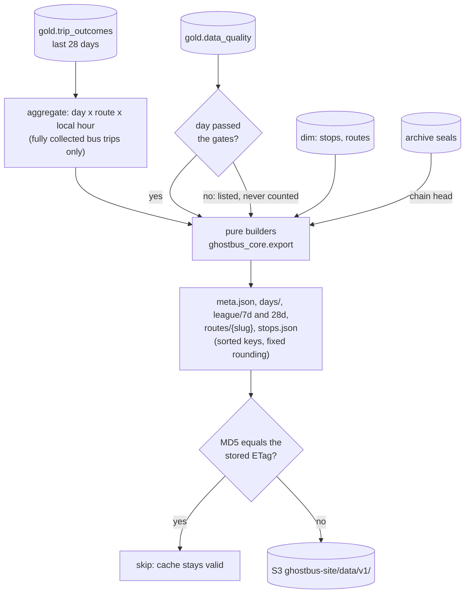
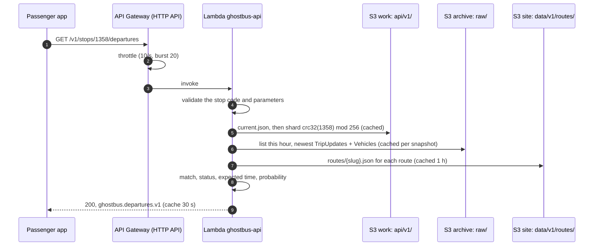
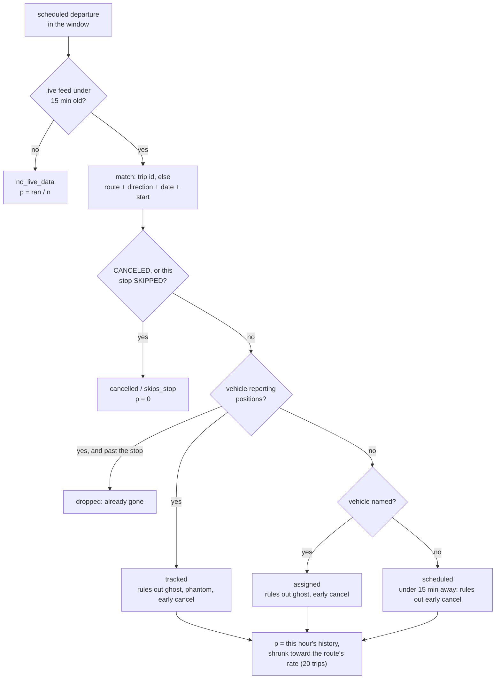
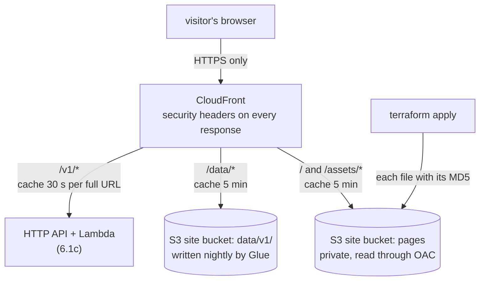
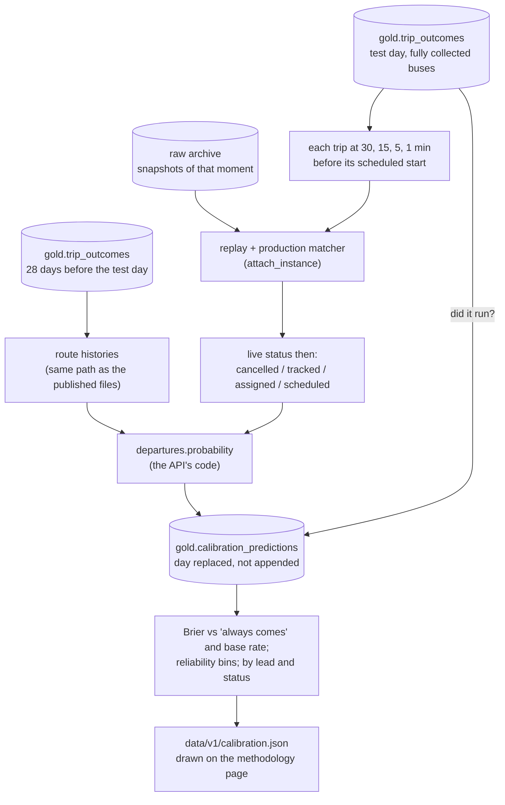
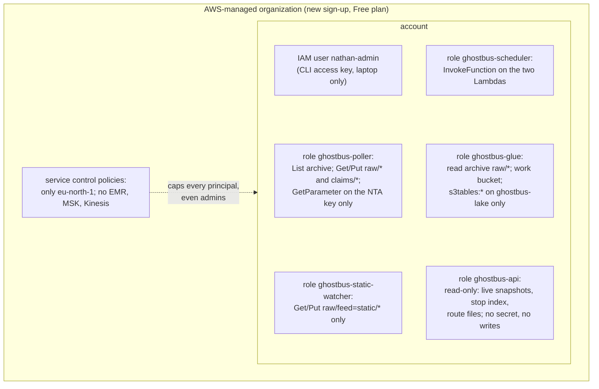
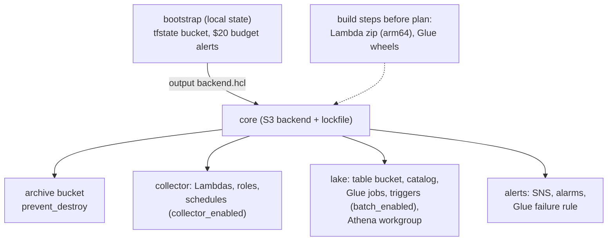
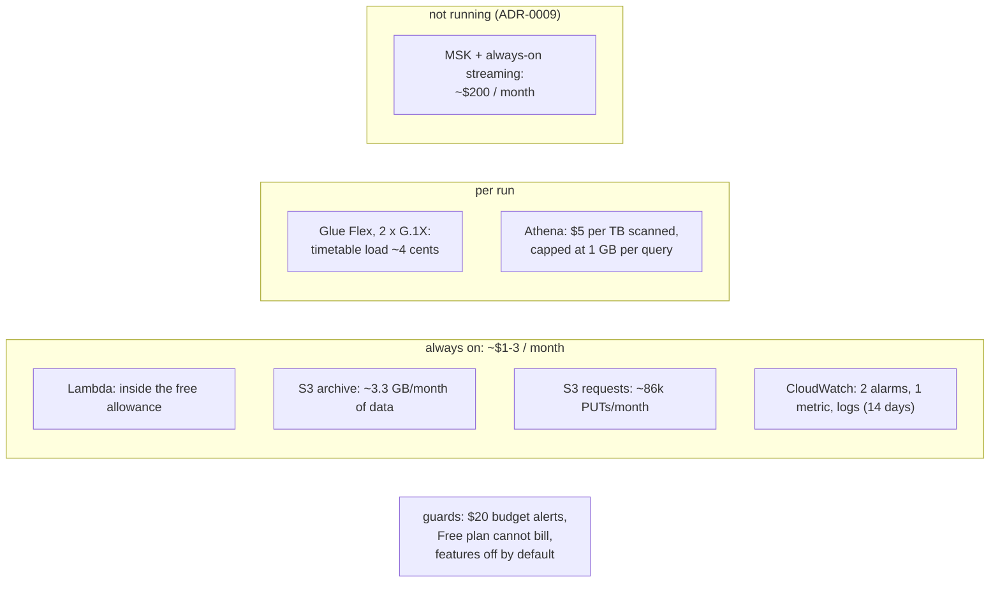

# 6. The cloud: AWS services, permissions, deployment and cost

What runs in AWS, who is allowed to do what, how it is deployed with Terraform, and how the bill
is kept to a few dollars.

## 6.1 AWS architecture (eu-north-1)

**Say it in one breath:** two schedules drive two Lambdas that fill an S3 archive; a nightly
Glue chain turns the archive into Iceberg tables in S3 Tables; Athena queries them through the
Glue Data Catalog; CloudWatch, EventBridge and SNS email when something breaks.

**Interviewer asks**
- *Why Lambda and not a small EC2 instance for the poller?* No server to patch, no idle cost, and
  the usage fits the always-free allowance. The trade-off is no memory between runs, solved by
  reading state from the archive.
- *Why Glue rather than EMR Serverless?* Both run the same Spark code. The account's Free plan
  denies EMR; Glue 5.1 matches the local Spark 3.5.6 / Iceberg 1.10 exactly (ADR-0010).
- *How does Athena see Iceberg tables in S3 Tables?* The table bucket is federated into the Glue
  Data Catalog as `s3tablescatalog`; Athena queries `"s3tablescatalog/ghostbus-lake".gold.trip_outcomes`.

## 6.1b The public data export

**Say it in one breath:** every night, after the quality checks, a job writes small JSON files
for the website, counting only days that passed the checks, ranking routes conservatively, and
re-uploading only files whose bytes changed.

**Interviewer asks**
- *Why static files instead of an API for this?* The site keeps working with every compute part
  switched off, it costs almost nothing to serve, and caches work perfectly because unchanged
  files are byte-identical. Live data ("will my bus come?") is a separate API.
- *How do you stop a bad day reaching the public?* The export reads each day's quality verdict;
  a failed day is listed with a note but counted in no rate, and a property test checks that no
  rate ever includes one.
- *How do you rank routes fairly?* By the lower end of the 95% interval of the untracked rate,
  with at least 30 trips. A small route with 2 bad trips out of 10 can't top the table.
- *How would you change the format without breaking the website?* Never in place: every file
  says `ghostbus.<kind>.v1` and validates against a JSON Schema; a breaking change is `data/v2/`.

## 6.1c "Will my bus come?" (the API)

**Say it in one breath:** a Lambda behind an HTTP API answers "what's coming to my stop, and
will it really come?" from three files in S3: the stop's timetable (a nightly index), the newest
live snapshot the poller already archived, and the route's published history. It never calls
the NTA, and a warm request usually makes one S3 list call and nothing else.

How each departure gets its status and probability (ADR-0012):

**Interviewer asks**
- *Why not stream to the API?* Streaming costs money every hour whether anyone asks or not. The
  poller already writes a snapshot every two minutes, and a snapshot decodes in 6 ms, so the API
  reads the newest one. The answer is at most one poll old, which is how old the data is anyway.
- *How do you hit p95 under 500 ms with S3 behind it?* Caching in the Lambda container: the index
  pointer for 5 minutes, shards and route files until they change, each live snapshot decoded once.
  A warm request is usually one S3 list call. Measured: `docs/measurements/06-api.md`.
- *Why shard the index?* 770,000 departures a day: one file per stop would be 10,000 uploads a
  night; one file would be tens of MB per request. 256 shards by `crc32(code)` is about 260 uploads
  and a ~100 KB read. `crc32`, not Python's `hash()`, which changes between processes.
- *What happens while the nightly index is being written?* Nothing visible: shards go under a new
  build prefix and the pointer `current.json` is written last, so readers switch from one complete
  build to the next (the same idea as a blue/green deploy, for data).
- *Is the probability any good?* It is a stated heuristic (`heuristic-v1`), not yet a measured one.
  Roadmap 2.4 scores it on held-out days (Brier score, reliability diagram) before it is trusted.
  Until a route has published history it answers `null` with the reason, never a guess.

## 6.1d The website

**Say it in one breath:** CloudFront serves static pages from a private S3 bucket, the nightly
JSON next to them, and passes `/v1/*` to the API, so the browser only ever talks to one origin;
every response carries strict security headers.

**Interviewer asks**
- *Why no React or build step?* Four pages and a few hundred lines of JavaScript. A framework would
  add a dependency tree to audit and patch, and a build whose output differs from what was
  reviewed. Plain modules are what ships.
- *Why route the API through CloudFront?* One origin for the browser, so the Content Security
  Policy can say `connect-src 'self'` and no CORS is involved; and CloudFront answers repeat
  questions about a busy stop for 30 seconds, which takes load (and cost) off the Lambda.
- *How do you deploy a change?* `terraform apply` uploads each changed file (it compares MD5s).
  Files carry `max-age=300`, so visitors see the change within 5 minutes without an invalidation.
- *How does the site stay honest before there is data?* It reads the same quality verdicts as the
  export: no published day means an empty league with the reason, never a number from a bad day.

## 6.1e Is the chance any good? (calibration backtest)

**Say it in one breath:** every night a job replays yesterday's archived live feed as it was 30,
15, 5 and 1 minutes before each bus was due, asks the model exactly as the API would have with
history from earlier days only, and scores it against what happened and against two simple rivals.

**Interviewer asks**
- *How do you avoid leaking the answer into the test?* Walk-forward: a test day's predictions use
  history from the days before it only, and the live status comes from snapshots fetched before the
  moment of prediction. The test day's own outcomes are only used to score.
- *Why a Brier score and not accuracy?* Accuracy throws the probability away (is 0.51 "comes"?).
  Brier rewards being confident when right and punishes being confident when wrong, and it is a
  proper scoring rule: you can't game it by shading your forecasts.
- *Why two baselines?* "Always comes" is what a timetable implies, the bar a passenger has today.
  One base rate for every bus is the bar for "the model knows something about this particular bus".
  On the first two days the model beat the first (+7%) and lost to the second (−8%).
- *What did the backtest find?* That 20% of buses showing "cancelled" shortly before departure
  still ran, and that routes with very little history get extreme guesses. Both are fixable
  (shrink routes toward the network rate; learn the chance that a cancelled bus still runs), and
  both would have stayed invisible without replaying the archive (measurement 08).

## 6.2 Who may do what (least privilege)

**Say it in one breath:** every component has its own IAM role with only the actions it needs on
only its own resources, and the account itself sits inside AWS-managed guardrails.

**Interviewer asks**
- *Where is the NTA API key and who can read it?* In SSM as an encrypted SecureString. Only the
  poller role can read that one parameter. It never enters Terraform state: Terraform knows only
  its name, and a script copies it from `.env` without printing it.
- *What is a service control policy?* An organization-level limit that applies to every identity in
  the account, including administrators. The account's first deploy failed with "explicit deny in a
  service control policy"; the IAM policy simulator then mapped exactly which actions and regions
  were allowed, before writing any more Terraform.

## 6.3 Terraform layers and deploy order

**Say it in one breath:** a tiny bootstrap layer (state bucket and budget) is applied once with
local state; everything else lives in the core layer, whose state is stored in that bucket with
locking, and nothing switches on until a flag says so.

**Interviewer asks**
- *Why two layers?* Terraform needs somewhere to keep its state before it can create that place.
  The bootstrap layer creates the state bucket with local state; the core layer then uses it.
- *How do you avoid deploying something live by accident?* Features ship disabled behind variables
  (`collector_enabled`, `batch_enabled`), plans are read before every apply, and the irreplaceable
  archive has `prevent_destroy`.
- *How do you keep the Lambda package reproducible?* The build installs Linux arm64 wheels from the
  lock file and writes a zip with fixed timestamps: same inputs, same bytes, so Terraform only
  redeploys on real changes.

## 6.4 Where the money goes

**Say it in one breath:** collection costs about a dollar a month, the nightly batch a few cents a
run, and Kafka plus always-on Spark (about $200 a month) is deliberately not running in the cloud.

**Beginner notes**
- **IAM role**: a set of permissions a service assumes; no passwords or keys are stored in code.
- **Terraform state**: Terraform's record of what it created, compared with the code on every plan.
- **Flex execution**: Glue runs the job on spare capacity for about a third less, starting a little
  later.
- **Federated catalog**: a catalog entry that points at tables managed by another service.
