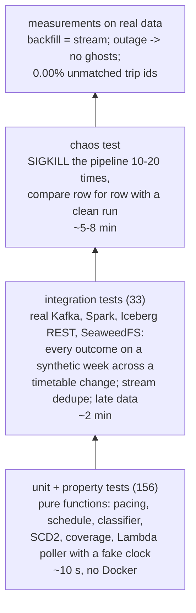
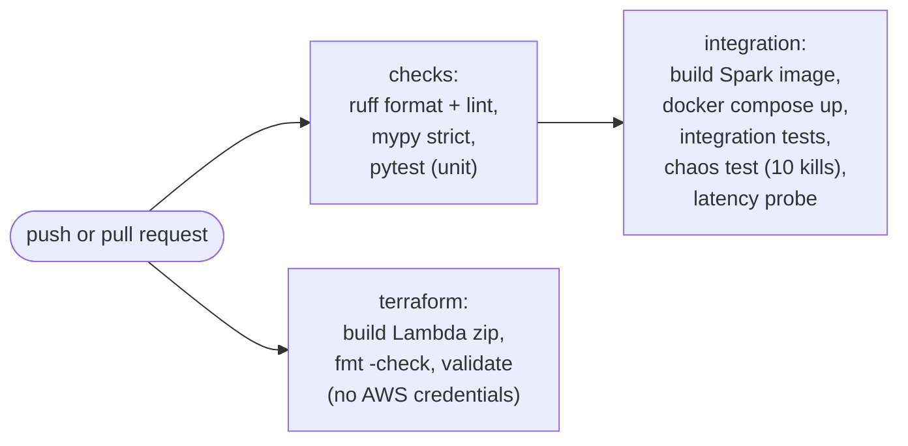
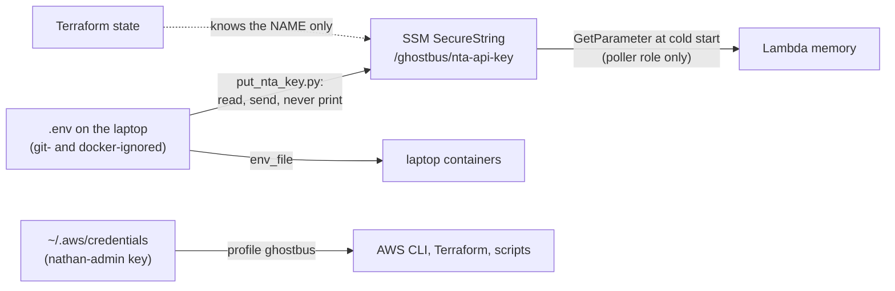
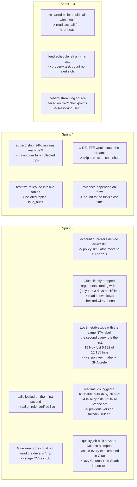

# 7. Engineering practice: tests, CI, secrets, and how bugs were found

Interviewers ask "how do you know it works?" more than "what does it do?". These diagrams answer
that.

## 7.1 The test pyramid

**Say it in one breath:** fast pure tests and property tests at the bottom, real Kafka, Spark and
S3 in Docker in the middle, and a chaos test that kills the pipeline at the top.

**Interviewer asks**
- *Why is most logic in pure functions?* Pure functions (no clock, no network, no Spark) can be
  tested exhaustively and quickly. The Lambda and the laptop poller share the same pacing function,
  and the stream and the batch share the same classifier.
- *Give an example of a property test.* "For any evidence, a collection gap never produces a
  ghost." Hypothesis tries hundreds of random cases; it found a real rule bug in Sprint 4.

## 7.2 Continuous integration

- CI never touches the AWS account or the NTA API: no secrets in CI, and no live calls in any test.

## 7.3 How secrets flow

**Say it in one breath:** the NTA key exists in exactly two places, `.env` on the laptop
(git-ignored) and SSM in AWS, and nothing in between ever prints or stores it.

## 7.4 Bugs the measurements found (good interview stories)

**How to tell one of these stories (STAR):** the **situation** (e.g. "the first rate said 94% of
buses ran"), the **task** ("is that number honest?"), the **action** ("split by coverage; found
1,040 'ran' decisions made through gaps where a missing bus would have been NO_DATA; changed the
rate sample and added a property test"), and the **result** ("87.2%, with the reason documented").
