# 8. Security

How the project is protected, why each control exists, and the evidence that it works. The threat
model behind it is [`docs/07-security.md`](../07-security.md). Security questions come up in almost
every interview, so this file ends with a question bank whose answers point to something real in
this repository.

## 8.1 Trust boundaries (where an attacker could stand)

**Say it in one breath:** data crosses five boundaries, from NTA to AWS, from the laptop to AWS,
between services, from GitHub to the world, and from the public internet to the API (8.10), all
inside AWS's organization rules; every arrow has a control on it.

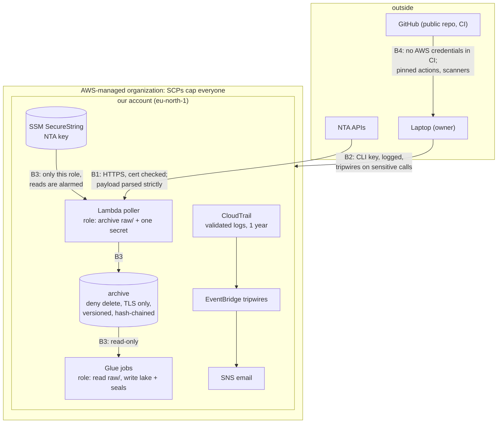

**Interviewer asks**
- *What is a trust boundary?* A line where data or control passes between parties that trust each
  other differently. Threat modelling starts by drawing them, because attacks happen at crossings.
- *Which boundary worries you most?* B2: a long-lived admin key on a laptop with no MFA (the
  account type cannot add it). It is mitigated, not solved (8.9).

## 8.2 How AWS decides whether a request is allowed

**Say it in one breath:** an explicit deny anywhere wins; otherwise the request needs to be allowed
by the organization's SCPs *and* by an identity or resource policy.

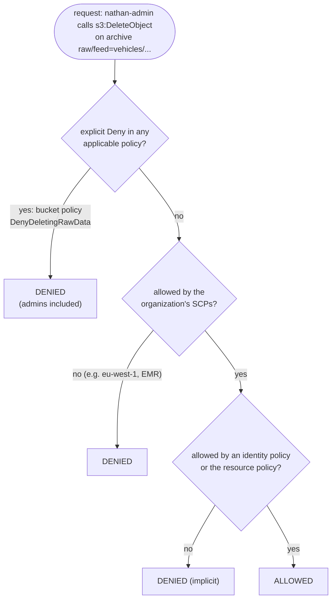

**Interviewer asks**
- *Can an administrator delete the raw archive?* No. `AdministratorAccess` is an allow; the
  bucket policy's explicit deny beats it. Tested: the delete was refused. Changing that needs a
  policy change, which is a Terraform commit, a CloudTrail event and a tripwire email.
- *What does an SCP do that IAM can't?* It limits the whole account, including its root and
  admins; it never grants anything. This account's AWS-managed SCPs restrict it to one region and
  a set of services; the first deploy failed on them and the IAM policy simulator mapped them.

## 8.3 Defence in depth around the archive

**Say it in one breath:** prevent, detect and attribute: the archive cannot be deleted, any change
to a sealed day is detectable from a copy outside AWS, and every change to the guardrails is
logged and alarmed.

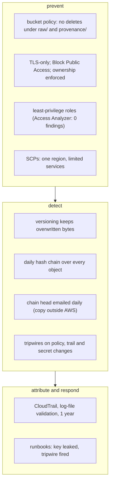

## 8.4 The NTA key's lifecycle

**Say it in one breath:** the key exists in exactly two places, `.env` on the laptop and an
encrypted SSM parameter, and every other place it could leak to is either excluded or checked.

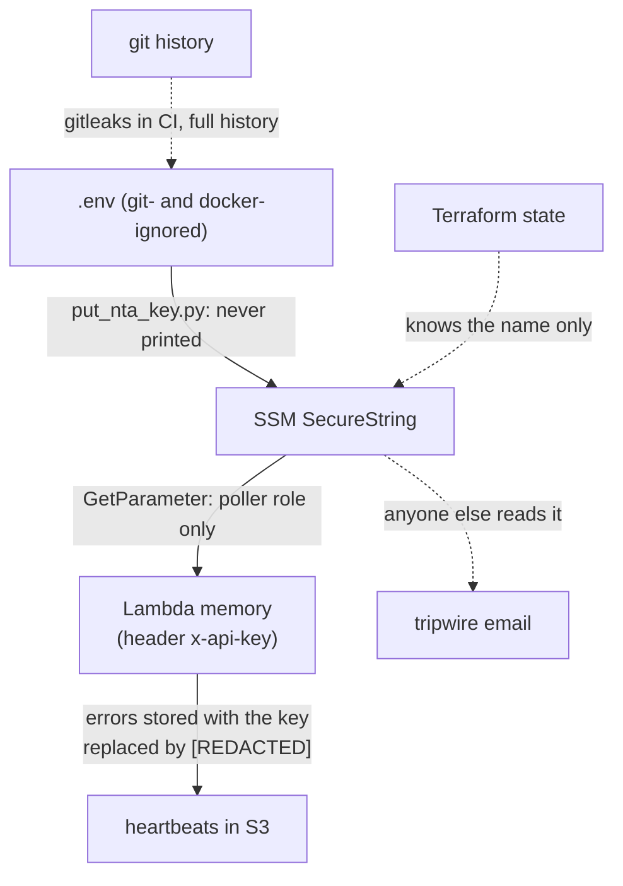

**Interviewer asks**
- *Why SSM Parameter Store and not Secrets Manager?* One static key, no automatic rotation to
  manage: a standard SecureString is free and encrypted with KMS. Secrets Manager ($0.40 a month)
  earns its price when it can rotate the secret itself, which NTA keys can't.
- *How do you know the key never ends up in a log?* It is only ever sent as a header; and because
  "never" needs proof, every stored error goes through redaction, with a test that puts the key into
  an exception and an error page and checks it is gone (and that the test fails without redaction).

## 8.5 Tamper-evident archive: the hash chain

**Say it in one breath:** every night each finished day of raw data is listed, hashed, and chained
to the day before, so changing any past object changes every later hash, and the latest hash
leaves AWS in the morning email.

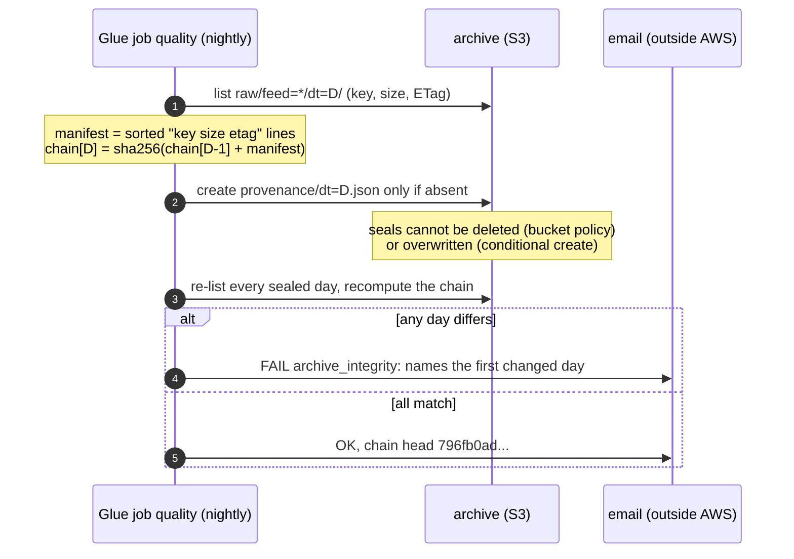

**Interviewer asks**
- *Why not S3 Object Lock?* Object Lock (WORM) is the stronger prevention and the natural next step;
  the chain adds something it doesn't: *proof to a third party*. Anyone with the chain head from an
  old email can check that today's archive still produces it.
- *Couldn't an attacker rewrite the seals too?* They would first have to lift the delete protection (a
  logged, alarmed policy change), then rewrite every later seal, and still not match the chain head
  already in past emails. The chain makes silent change impossible, not just unlikely.
- *Isn't an ETag MD5, which is broken?* For collision resistance against a determined attacker, yes;
  here it fingerprints each object inside a SHA-256 chain, and the threat is undetected edits, which
  would also have to pass versioning and CloudTrail. Upgrading to S3's SHA-256 checksums is a
  config change (noted as a follow-up).

## 8.6 Tripwires: alerts on sensitive actions

**Say it in one breath:** CloudTrail records every management call, EventBridge matches the
dangerous ones, and a readable email names who did what, from where.

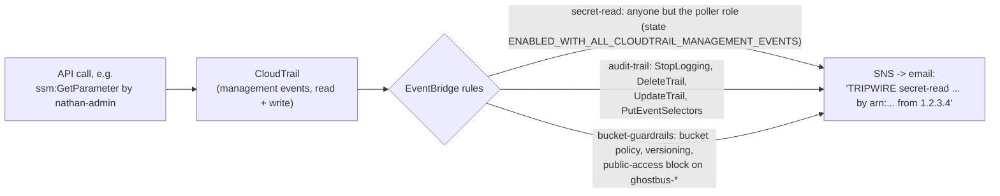

**Interviewer asks**
- *Why did reading a secret need a special rule state?* EventBridge ignores read-only events
  (Get/List/Describe) unless the rule's state is `ENABLED_WITH_ALL_CLOUDTRAIL_MANAGEMENT_EVENTS`.
  A tripwire on secret *reads* with the default state would silently never fire.
- *How did you test them?* By doing each sensitive thing once on purpose: reading the key's
  metadata, re-applying the trail's own settings, re-applying a bucket policy. Each produced one
  email; the EventBridge `TriggeredRules` metric confirmed it.
- *Won't they fire on your own deploys?* Yes, on purpose. "Expected right after a deploy you made"
  is in the email; an alert nobody can explain is the signal.
- *Why no tripwire on IAM changes or console sign-in?* Those events are global and arrive in
  us-east-1, which this account's SCPs block. Documented as an accepted gap; the MFA-protected owner
  sign-in (AWS Builder ID) covers the
  biggest part of it.

## 8.7 The software supply chain

**Say it in one breath:** everything that runs is built from a lock file, scanned for known
vulnerabilities and secrets on every push, built reproducibly, and the scanners themselves are
pinned so they can't be swapped under us.

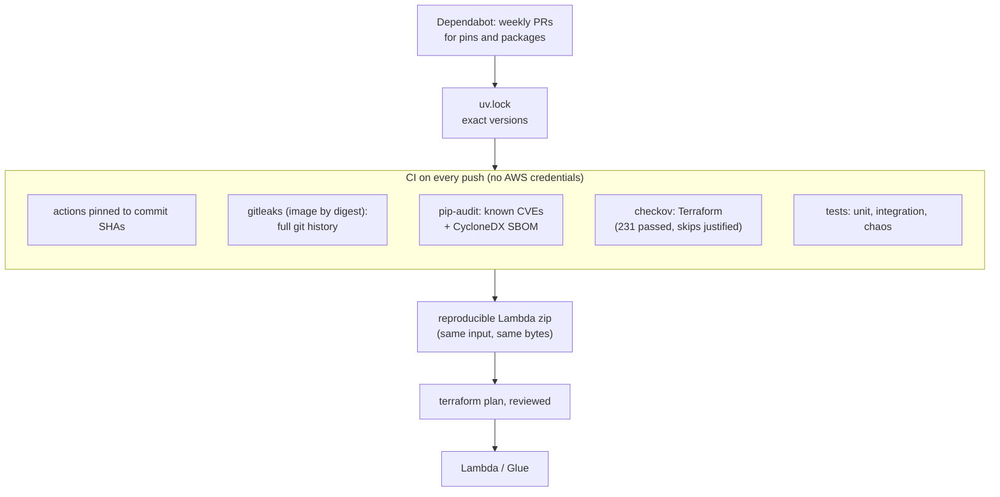

**Interviewer asks**
- *Why pin actions to SHAs?* A tag is a pointer anyone with write access can move. In 2026 attackers
  force-pushed 76 of Trivy's 77 release tags to malicious commits, and every workflow using
  `trivy-action@v...` ran their code. A commit SHA can't be moved. Dependabot keeps the pins current.
- *What did your scanners find?* pip-audit found CVE-2026-32773 in PySpark 3.5.6 (an XSS in the Spark
  History Server). Triaged: not reachable, because no History Server runs anywhere and only the
  owner launches jobs; upgrading locally would break parity with Glue's Spark 3.5.6. Suppressed by
  ID only, with a re-check date, so any new advisory still fails the build. gitleaks found one false
  positive (`key=key` in a Kafka call), ignored by its exact fingerprint.
- *What is an SBOM for?* A list of every component in what you ship. When the next Log4Shell lands,
  the question "are we affected?" becomes a search, not an investigation.

## 8.8 Incident: a tripwire fired

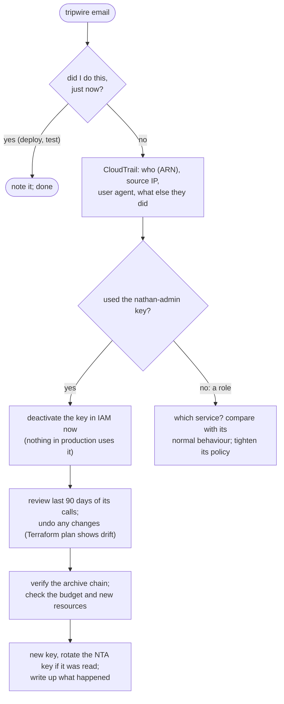

## 8.9 The accepted risk: an admin key without MFA

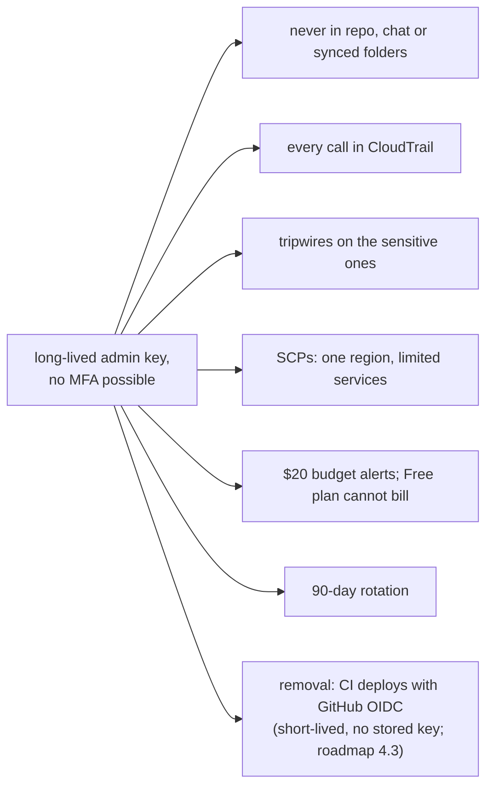

---

## 8.10 The public API's edge (boundary B5)

**Say it in one breath:** anyone on the internet can call the API, so every layer between them
and the data narrows what they can do: the edge limits how much, the code limits what, and the
role limits where, and the data they can reach is public anyway.

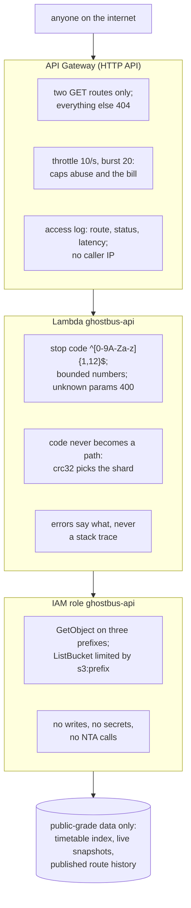

**Interviewer asks**
- *Walk me through what stops a malicious request.* The gateway refuses any route but two and
  throttles everyone together; the Lambda refuses any input that isn't a short alphanumeric code
  or a bounded number; even a bug past both runs under a role that can only read public-grade data.
  Questions 31 to 36 below go into each layer.

## 8.11 The website in the browser (boundary B5, part 2)

**Say it in one breath:** the site can only run its own code: the Content Security Policy refuses
anything else, the code never turns data into markup, and a test fails the build if either
promise is broken.

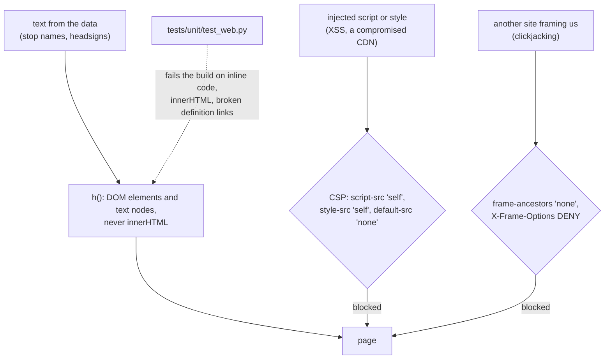

**Interviewer asks**
- *Isn't CSP enough on its own?* It's the second line. The first is never creating markup from
  data, so there is nothing to inject into; the CSP limits the damage if the first ever fails, and
  the test keeps both true as the code changes.

## Question bank

Short, honest answers you can give, each tied to something you can show.

### Fundamentals

1. **What does CIA mean, and which matters most here?** Confidentiality, integrity, availability.
   Integrity: the product is trustworthy numbers. Confidentiality matters for one secret and some
   field-check data; availability is handled by NO_DATA rather than by uptime promises.
2. **What is least privilege, concretely, in your project?** Four roles, each limited to its own
   resources; for example the poller may read one SSM parameter and write `raw/` and `claims/` in
   one bucket. Glue moved off the broad AWS-managed `AWSGlueServiceRole` to a policy listing only
   what its jobs use, verified by a full run. Access Analyzer reports 0 findings.
3. **Defence in depth?** Several independent layers so one failure isn't a breach: for the archive,
   prevent (deny delete), detect (versioning, hash chain, tripwires) and attribute (CloudTrail). 8.3.
4. **How do you threat-model?** Draw the data flow and trust boundaries, then walk STRIDE per element
   (Spoofing, Tampering, Repudiation, Information disclosure, Denial of service, Elevation of
   privilege), and record a control, a status and the evidence for each. `docs/07-security.md`.
5. **Encryption at rest and in transit?** In transit: HTTPS everywhere, and buckets refuse plain HTTP
   (tested). At rest: SSE-S3 on every bucket, KMS for the SecureString, S3 Tables and Glue output
   encrypted server-side.

### AWS identity and access

6. **IAM user vs role?** A user has long-lived credentials; a role is assumed and hands out
   temporary ones. Every service here uses a role; the only user is the human operator, a gap with
   a planned fix (OIDC).
7. **Identity policy vs resource policy?** Identity policies attach to who; resource policies to what.
   The archive's "no deletes" lives in the bucket policy, so it applies to every principal, even
   ones whose identity policy allows everything.
8. **What is the confused deputy problem, and where did you handle it?** A service acting for you can
   be tricked into acting for someone else. Our trust and resource policies pin the caller: the
   scheduler role only trusts `scheduler.amazonaws.com` from our account (`aws:SourceAccount`); the
   SNS topic and CloudTrail bucket only accept our specific rule and trail ARNs (`aws:SourceArn`).
9. **How do you validate policies?** IAM Access Analyzer `validate-policy` on every deployed identity
   and bucket policy (0 findings), and the policy simulator for "would this be allowed?" questions,
   which is how the account's SCPs were mapped before writing more Terraform.
10. **Root user?** On this account, the IAM root user has no password at all; the account is owned by
    an AWS Builder ID that signs in with Google plus an authenticator-app MFA. The audit first
    flagged "root MFA off" (`AccountMFAEnabled = 0`), then the credential report and the Builder ID
    page showed the control simply lives elsewhere. Good answer to *"tell me about a false positive"*:
    an audit signal is only as good as its model of the system.

### Secrets

11. **Where is your API key, and who can read it?** 8.4: `.env` and SSM only; one role can read it;
    any other reader triggers an email.
12. **A secret was pushed to Git. What now?** Revoke and rotate it first (it is public the moment it
    is pushed, even if deleted); then purge history if needed. gitleaks scanning the *full* history in
    CI is what catches the case of "committed, then deleted".
13. **Why not put secrets in Lambda environment variables?** They show in the console and in
    configuration reads; anyone with `lambda:GetFunctionConfiguration` sees them. Reading from SSM at
    cold start keeps the value out of the function's configuration.

### Data integrity

14. **How would you prove your published numbers weren't manipulated?** Derive them only from the raw
    archive, make the archive undeletable, and seal each day into a hash chain whose head is copied
    outside AWS daily. Anyone can recompute it (`provenance verify`). 8.5.
15. **What else threatens integrity besides attackers?** Our own bugs. The nightly quality gates
    (FAIL means don't publish) caught or would have caught every real data bug in this project, and
    the rules never let our downtime count as a ghost.

### Detection and response

16. **What do you log, and for how long?** CloudTrail management events with file validation for a
    year; application logs for 14 days (no audit value, they cost money).
17. **How would you know someone was in your account?** Tripwires on the sensitive actions (8.6),
    budget alerts on unusual spend, and the daily email's integrity check on the data itself.
18. **Walk me through your response to a leaked key.** 8.8: contain (deactivate), investigate
    (CloudTrail), eradicate (undo drift, rotate), recover (verify archive chain), learn (write-up).
    Nothing in production uses the human key, so revoking it is safe in minutes.
19. **Why not GuardDuty or Security Hub?** Not available on this account's plan. The tripwires cover
    the most important signals for this system, at no cost; on a Paid plan, GuardDuty is the first
    thing to turn on.

### Supply chain and CI/CD

20. **How do you secure CI/CD?** No cloud credentials in CI at all today; read-only token
    permissions; actions pinned by SHA; scanners pinned by version or image digest; Dependabot for
    updates. Next step: deploy from CI with GitHub OIDC (short-lived, no stored keys).
21. **How do you handle a CVE in a dependency?** Read it, check reachability, decide, record. Example
    in 8.7: not reachable, documented, suppressed by ID with a re-check date.
22. **What is a reproducible build, and why does it matter for security?** Same inputs produce the
    same bytes, so you can check that what runs is what the source says. The Lambda zip here is
    byte-identical between builds (fixed timestamps, locked wheels).
23. **SLSA?** A framework for build integrity levels (provenance, hermetic builds, signing). This
    project has the early pieces: lock files, reproducible artifacts, pinned toolchain, SBOM; Lambda
    code signing with AWS Signer is the planned next step.

### Judgement questions

24. **Why didn't you encrypt everything with customer KMS keys?** Cost (about $1 a month per key plus
    API calls) against benefit: no regulated data, and AWS-managed encryption already applies. For
    SNS it would even break alerting, because EventBridge and CloudWatch can't publish to a topic
    encrypted with the AWS-managed key. Every such decision is written next to the scanner skip.
25. **Your Lambda isn't in a VPC. Isn't that less secure?** A VPC protects private network
    resources; this function talks only to a public API and to S3 through IAM. A VPC would add a NAT
    gateway (about $35 a month) and no protection that IAM doesn't already give.
26. **What is your biggest remaining risk?** The MFA-less admin CLI key (8.9). It is contained,
    logged and alarmed, and the fix (OIDC deploys, then removing the key) is planned.
27. **What would you do with a bigger budget?** Object Lock on the archive, GuardDuty, CloudTrail
    data events for the archive, KMS customer keys with key policies per service, Lambda code
    signing, and a second account for development.
28. **Denial of wallet?** An attacker (or bug) running up your bill. Here: a $20 budget with alerts,
    a Free plan that cannot bill, Flex Glue with a timeout, an Athena 1 GB per-query cap, and every
    schedule behind a flag.
29. **How do you handle personal data?** Field-check observations (where someone stood, when) are
    git- and docker-ignored and never uploaded; the only other personal data is the alert email,
    stored in Terraform variables that are git-ignored.
30. **Tell me about a security bug you found yourself.** The Sprint 4 one: an integration test
    published fake data to the live Kafka topics, including fake "collected" heartbeats that could
    have hidden real outages. Found by an archive-vs-lake comparison, fixed by isolating test topics,
    and now checked by `lake_audit`.

### The public API (roadmap 2.3)

31. **Your API has no authentication. Why is that acceptable?** It serves public, read-only open
    data, the same as the website. Authentication answers "who are you?"; there is nothing here
    that depends on who asks. The real risks are abuse and cost, so the controls are throttling at
    the edge (10 requests a second, bursts of 20, so the worst case is a known number of cents),
    strict input validation, and a Lambda role that can only read three S3 prefixes. If keys were
    ever needed (per-client quotas), API Gateway usage plans would come before writing any auth code.
32. **What could an attacker do with the API's role if the Lambda were compromised?** Read the
    newest live snapshots, the stop index and the route files: all data the public gets anyway.
    It cannot write anything, cannot list other prefixes (`ListBucket` is limited with an
    `s3:prefix` condition), and cannot read the NTA key. Least privilege turns "compromised" into
    "embarrassing", not "breach".
33. **How do you validate input?** A stop code must match `^[0-9A-Za-z]{1,12}$` before it touches
    anything; `minutes` and `limit` must be whole numbers in a range; unknown parameters are
    refused with a 400 and a message. The code never builds an S3 key from raw input: it becomes a
    shard number through `crc32`, so path tricks like `../` have nothing to reach.
34. **Do you log IP addresses?** No. Under GDPR an IP address is personal data, and nothing here
    needs it. The access log records the route, path, status and latency; the Lambda logs one line
    per request with the stop code only if it is valid, so nothing a caller types reaches the logs
    unchecked (no log injection).
35. **Why is CORS set to `*`? Isn't that insecure?** CORS protects users' credentials from other
    sites. This API takes no credentials and no cookies and allows GET only, so any origin may read
    it, which is the point of open data. `*` would be wrong on an API that used cookies.
36. **What happens when your data is old or missing?** The answer says so instead of guessing: live
    data older than 5 minutes is labelled `stale`, older than 15 minutes is not used (every bus shows
    `no_live_data`); an expired index is a 503 with the reason; a route with no published history has
    probability `null` with the reason. Failing loudly is a security property too: a confident
    wrong answer is how people get misled.

### The website (roadmap 2.2)

37. **What is a Content Security Policy, and what does yours say?** A response header telling the
    browser which sources a page may load code and data from. Ours: nothing by default
    (`default-src 'none'`), scripts, styles and fetches only from our own origin, no plugins, no
    framing (`frame-ancestors 'none'`), no `<base>` tricks (`base-uri 'none'`). An injected
    `<script>` or inline `onclick` simply does not run. It works because the site has no inline
    code at all, and a test keeps it that way.
38. **How do you prevent XSS?** By never turning data into HTML: every element is built with
    `createElement` and text nodes, so a stop called `` is displayed as those
    characters. The CSP is the safety net, not the plan. A test fails if any script uses
    `innerHTML`, `outerHTML`, `insertAdjacentHTML`, `document.write` or `eval`.
39. **Why isn't the S3 bucket public, if the website is?** Public buckets are how most S3 data leaks
    happen, and a public bucket would bypass CloudFront's headers and caching. Block Public Access
    stays on; CloudFront reads through origin access control, signing each request, and the bucket
    policy allows only this distribution's ARN to read.
40. **What is cache poisoning, and did you have to think about it?** Getting a cache to store a
    harmful response under a key that normal users request. I nearly built one: the first API cache
    key used only the known query strings, so `?minutes=60&junk=1` (a 400 error) could have been
    cached as `?minutes=60` and served to everyone for a few seconds. The cache key now includes
    every query string.
41. **What does HSTS do here?** It tells browsers to use HTTPS for this host for a year, so a
    network attacker can't downgrade a later visit to plain HTTP. `preload` is left off: it only
    means something for a domain we own, which comes with a custom domain.
42. **Why no analytics or access logs on the website?** Both would collect visitors' IP addresses
    and browsing, which this project doesn't need. Data you never collect can't leak, and it keeps
    the site free of cookie banners. The cost is not knowing traffic in detail; CloudFront's
    aggregate metrics are enough.

